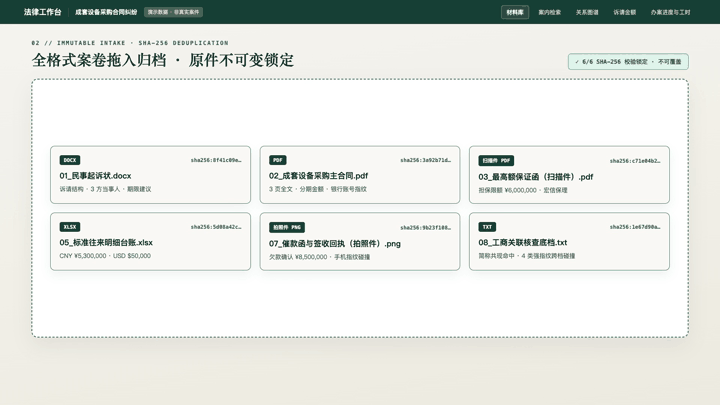
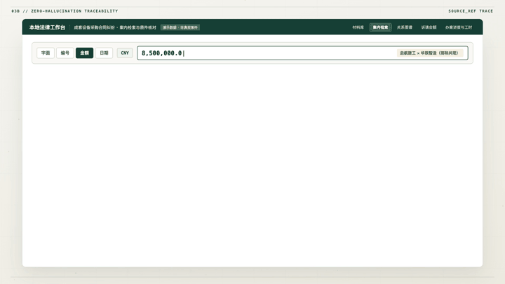
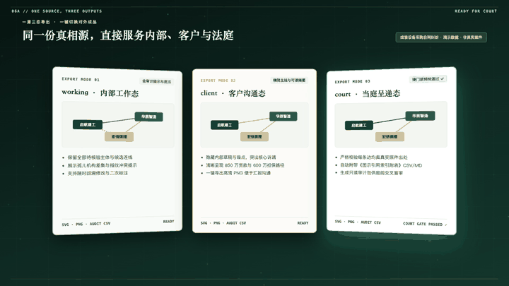

<div align="center">


<p>
  <strong>素章（PlainFolio）—— 一款专为诉讼律师打造的离线案件工作台</strong><br/>
  把杂乱的合同、扫描件、银行流水、起诉状留在自己的电脑里：秒查原件出处、梳理主体与诉请账目、按法院规范一键自动装卷；内置五套素系配色（含纯粹灰度模式），顶栏一键切换。
</p>

</div>

> **数据只留在你自己的电脑里**
> 所有案卷文件、检索记录与案件进度均保存于你本机的硬盘中，不联网、不经过任何外部服务器、无账号体系也无云端同步；断网或涉密环境下照常全速使用。

---

## 它能帮你把哪些耗时工作省下来？

- **首页案件总台账（一眼看清轻重缓急）**：集中登记**案号、原被告、办理状态**（正常推进 / 待补材料 / 待沟通开会 / 待法院对方 / 暂缓中止）、当前节点与跨案期限时间轴；支持按关键词、状态、逾期/近 7 天期限快速筛选和排序，已结案件可随时归档只读封存。
- **全格式材料库与扫描件识别**：把整个案卷文件夹直接导入本机工作台，自动校验并按内容去重；无论 Word、Excel 表格、纯文本还是模糊扫描 PDF 与照片（包括多页扫描件），全部在本地自动转为可检索文字，同时原始文件只读锁定、永不覆盖。
- **四模式精确查页与原件对照**：按关键词、金额（人民币/外币严格分账不混算）、日期或编号全文秒查，点开任何一条结果直接跳到对应的 PDF 页码或原文段落旁核对。
- **主体关系图、证据目录与诉请算账**：同一个案子支持拆多张关系图，自动扫描跨材料碰撞的**手机号、统一社会信用代码、银行账号与邮箱**防漏暗线；证据目录调序后编号（`证据1-1`）全案同步更新；诉请金额按本金、利息、违约金、抵扣精准算账，避免表格公式算串行。
- **法院标准一键自动装卷**：确认好证据目录与页码范围后，点一下**「一键装卷（ZIP）」**自动产出两套成品：
  - **线下打印版**：A4 规范排版、左侧预留 20mm 装订线、封面（自动带入案号与原被告）＋精确页码《证据目录》＋分隔页＋右下角连续编页（右上角严格留白供书记员归档）的整本合订 PDF，及可编辑 Word 版目录。
  - **网上立案版**：按 `证据1-1_名称.pdf` 统一裁切排好序的分项单份材料，可直接用于「人民法院在线服务」逐条提交。
- **区分内部草稿、客户汇报与当庭呈递**：图表支持按「内部工作 / 客户沟通 / 当庭呈递」三种场景一键导出，上庭版未绑定可靠出处会自动拦截提醒。如需接入外部 AI 助手协同，工作台默认锁死（`deny_all`），只有律师在本机显式放行单个案件后才可读该案，严防涉密案卷串读；AI 提出的修改默认进待确认收件箱，由律师逐条点确认后才算定稿。

---

## 实际操作长什么样？

<table>
  <tr>
    <td width="50%" align="center">
      <strong>1. 全格式案卷导入与本机离线识别</strong><br/>
      
    </td>
    <td width="50%" align="center">
      <strong>2. 按金额/关键字秒查并直达原件页码</strong><br/>
      
    </td>
  </tr>
  <tr>
    <td width="50%" align="center">
      <strong>3. 主体关系梳理与跨材料强指纹防漏</strong><br/>
      
    </td>
    <td width="50%" align="center">
      <strong>4. 内部 / 客户 / 法庭三态导出与复核</strong><br/>
      
    </td>
  </tr>
</table>

> 想看完整 2 分钟全流程高清演示视频？可在 GitHub 仓库右侧 **Releases** 页面下载 `1080p` 演示视频直接观看（演示内容全部为虚构测试案例，无任何真实案件信息）。

---

## 日常怎么打开？（Mac / Windows 双端共用）

首次配置好之后，平时办案**不需要敲任何代码或命令**：

| 系统 | 日常启动方式 | 说明 |
|---|---|---|
| **macOS** | 双击根目录 **`法律工作台.app`** | 自带工作台图标，自动拉起本地服务与后台识别并在浏览器打开工作台 |
| **Windows 10 / 11** | 双击根目录 **`法律工作台.bat`** | 无黑框后台静默启动；运行一次 `powershell -ExecutionPolicy Bypass -File scripts\create-windows-shortcut.ps1` 可生成带图标桌面快捷方式 |

> **小提示（Windows 用户）**：请把本工具和案卷数据放在本机普通硬盘分区（例如 `D:\案件工作台`，NTFS 格式），不要放到云盘同步目录或 U 盘中；如电脑存有敏感案件，建议同时开启系统自带磁盘加密（macOS FileVault / Windows BitLocker）。

---

## 首次在本机安装准备

<details>
<summary>点此展开：macOS / Windows 首次安装与初始化步骤（只需做一次）</summary>

### macOS（Apple Silicon）

1. 在终端安装运行环境并拉取离线识别模型（仅下载依赖和 OCR 模型时需联网）：
   ```sh
   brew install python@3.13 uv node postgresql@18
   cd backend && uv sync --locked && cd ..
   cd frontend && npm ci && npm run build && cd ..
   scripts/install_ocr_models.py
   ```
2. 初始化本地数据目录并首次启动：
   ```sh
   scripts/lwb init
   ```
   完成后浏览器访问 `http://127.0.0.1:8765/`；以后日常使用只需双击 `法律工作台.app`。

### Windows 10 / 11

1. 提前安装本机依赖：**Python 3.13**（含 `pythonw.exe`）、**uv**、**Node.js 22+** 与 **PostgreSQL 18**（安装即可，无需手动启动系统数据库服务）。
2. 打开 PowerShell 进入项目目录执行：
   ```powershell
   cd backend; uv sync --locked; cd ..
   cd frontend; npm ci; npm run build; cd ..
   backend\.venv\Scripts\python.exe scripts\install_ocr_models.py
   scripts\lwb.cmd init
   ```
   完成后即可通过 `http://127.0.0.1:8765/` 使用；以后日常只需双击 `法律工作台.bat`（详见 [Windows 检查清单](docs/WINDOWS_CHECKLIST.md)）。

</details>

---

## 建议先用内置虚拟案卷试用一遍

在导入你的第一份真实案卷前，建议先用项目自带的虚构测试材料 [acceptance_simulation](acceptance_simulation/README.md)（包含采购合同、扫描保证函、多页对账单、现场照片与民事起诉状）跑一遍「导入 → 检索 → 整理关系与目录 → 一键装卷」，确认顺手后再放真实案卷，并记得养成定期本地备份的习惯（[备份与恢复指引](docs/BACKUP_RESTORE.md)）。

---

<details>
<summary>给律所 IT / 开发者与 AI 助手（技术架构、接口与日常命令行）</summary>

- 技术与数据模型：[系统架构](docs/ARCHITECTURE.md) · [数据表与约束](docs/SCHEMA.md) · [HTTP 接口与 OpenAPI](docs/API.md) · [外部 Agent / MCP / CLI 接入指南](docs/AGENT.md) · [通用 Agent 插件包](plugins/plainfolio/README.md)（便携 MCP + 业务 Skills；默认锁死、不提供常驻宿主插件）
- Agent 授权：接进任何 MCP 客户端时，工作台默认锁死（`deny_all`），只能由你在本机按案放行：`scripts/lwb agent-status`（看状态）· `scripts/lwb agent-grant <case_id>`（临时放行单案）· `scripts/lwb agent-revoke <case_id>`（收回）· `scripts/lwb agent-lock`（立即全局锁死）· `scripts/lwb agent-allow-all --confirm`（全开，仅限本地模型）。Windows 用 `scripts\lwb.cmd`。
- 桌面分发：[安装包打包与实机验收清单](docs/PACKAGING.md)（macOS `.dmg` / Windows `.exe`；工程已实现，尚未在真机构建与安装）。
- 日常运维：`scripts/lwb doctor`（体检）· `scripts/lwb migrate`（升级表结构）· [备份与恢复命令](docs/BACKUP_RESTORE.md)（`cli backup` / `verify-backup` / `restore`）· 实机验收与测试基线见 [测试报告](docs/TEST_REPORT.md) 与 [变更记录](CHANGELOG.md)。

</details>
