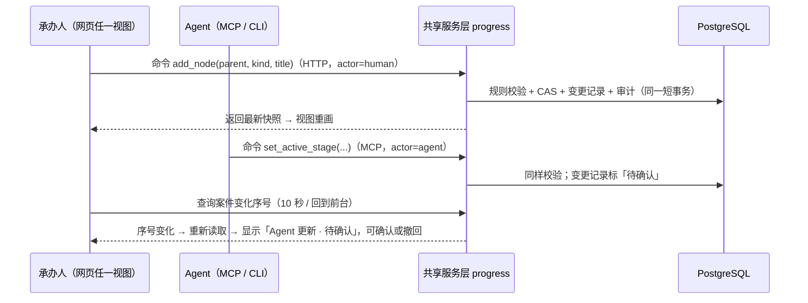
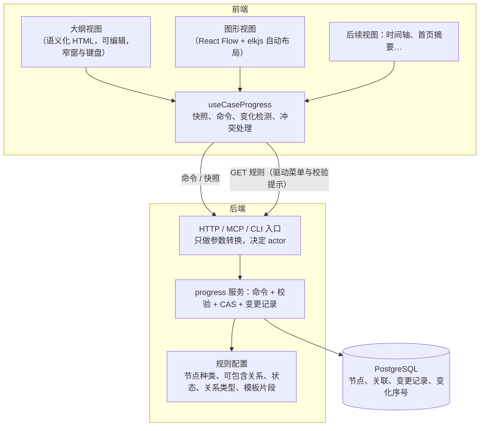
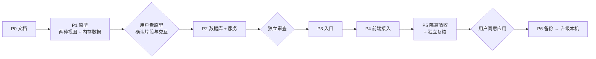

# 办案进度可视化 · 总体计划（重做版）

> 状态：**已封板（P2–P6 及 D1/D2 修复已应用至 `0006_case_archive_time`，低优先余项已转 NEXT_STEPS）** · 建立 2026-11-16 · 最近更新 2026-11-22
> 基线：由 `0004_case_workbench` 升至 `0005_case_progress` → `0006_case_archive_time`；后续扩展另开新变更单。
> 已确认：Q1 默认模板按建议；Q2 Agent 可改当前阶段，显示「Agent 更新 · 待确认」，承办人可一键撤回；Q3 首页改为「进行中」；Q4 先做原型。
> 方法调整：讨论纪要只用作**场景素材**，不作为设计前提。每个决定从办案实际对象推导，并区分「结构性决定（以后很难改）」和「范围/策略（以后改配置或增量加功能即可）」。

---

## 一、核心问题：界面、数据库、Agent 的关系

这部分和纪要无关，保持上一版结论：



1. **数据库是唯一事实来源，图形界面是它的投影。** 人工点击也是先写库、后显示。
2. **操作定义为业务命令**，网页、MCP、CLI 共用同一服务函数，只有 `actor` 不同。没有“整图保存”。
3. **Agent 不通过浏览器操作业务数据**；浏览器只用于验收。

---

## 二、从办案实际推导需要表达的东西

以专利/知识产权诉讼的常见情形检验模型，而不是从“进度条”出发：

| 实际情形 | 对模型的要求 |
|---|---|
| 一审中提管辖异议，管辖异议被裁定后又上诉 | 程序里嵌套子程序，子程序有自己的阶段 → **层级不能固定** |
| 侵权诉讼同时，被告对专利提无效宣告，之后可能有行政诉讼 | 一案内**多条并行程序** |
| 无效决定导致侵权诉讼中止 | 节点之间存在**非包含关系**（引起、中止、依据） |
| 庭前程序中多次证据交换，每次下面还有补充证据、质证意见 | 工作/事件**可以再分解** |
| 二审、发回重审、再审 | 程序可**按需插入**，内部阶段可预设 |
| 庭审时间、判决送达、上诉期 | 节点有**日期和期限**属性 |
| 证据整理关联具体材料、分析成果、标注 | 节点**引用**已有业务对象 |
| Agent 改了阶段，承办人不同意 | 需要**撤回**某次修改 → 必须知道修改前是什么 |
| 以后加 FTO、无效、OA 答复等案件类型 | 种类、阶段、模板**不能写死在代码结构里** |

由此得到三个结构性结论：

- **节点是一棵不限层级的树**（包含关系），另加**类型化关系**表达非包含关系。层级深度、哪些节点能放在哪里，由规则配置决定，不由数据库结构或界面组件决定。
- **所有修改留下“修改前/修改后”的变更记录**，这是撤回、待确认、历史时间线的共同基础。
- **视图和数据彻底分开**：同一份数据可以有多种画法，加画法不动数据。

---

## 三、分层架构



每层能变什么、不该变什么：

| 层 | 承担 | 变化方式 |
|---|---|---|
| 数据库 | 通用结构：树、关联、关系、变更记录 | 稳定；新增能力原则上只加表/加列 |
| 规则配置 | 种类、谁能包含谁、可用状态、模板片段、Agent 可用命令 | 改配置，不迁移数据库 |
| 服务命令 | 业务不变量（同案、无环、CAS、审计） | 新命令是增量 |
| 前端状态 | 快照、命令、刷新 | 与视图无关 |
| 视图 | 只负责画和把操作翻译成命令 | 可增加、替换；不含业务规则 |

前端菜单（“这里可以加什么节点”“可以设哪些状态”）从后端规则接口读取，所以**新增一种节点或允许第三、四层，不需要改前端代码**。

---

## 四、关键决策

| # | 决策 | 结构性？ | 理由 / 以后如何扩展 |
|---|---|---|---|
| K1 | 节点存为**不限层级的树**：`parent_id` 自引用 + 同级 `position` | 是 | 覆盖嵌套程序与工作分解；限制交给规则 |
| K2 | **节点种类由规则配置定义**。首版种类：程序、阶段、事件、工作；数据库只校验非空，种类合法性由服务按配置校验 | 是 | 加种类只改配置；代价是种类枚举不在数据库 CHECK 中，由服务层测试兜底 |
| K3 | **状态按种类配置**（如阶段：未开始/进行中/已完成/已跳过；工作：未完成/已完成/取消；事件：计划/已发生/取消）。“当前阶段”= 状态为进行中的阶段，规则约束同一程序内最多一个 | 是 | 并行程序天然各有当前阶段；回退只是改状态 |
| K4 | **非包含关系用独立关系表**（起点、终点、类型），类型由配置定义。首版建表与命令，界面只开放「引起」「关联」两种 | 是 | 中止、依据等以后加类型即可；包含关系永不暗示先后或依赖 |
| K5 | **变更记录**：每个命令在同一事务写一条，含每个受影响节点的修改前/后值与修订号；Agent 的变更为「待确认」，人工可确认或撤回。撤回是一条新的反向命令，仅当受影响节点之后未再变化时允许，否则提示冲突由人工处理 | 是 | 满足 Q2，并统一适用于 Agent 的所有进度修改；同时得到修改历史 |
| K6 | **模板由“片段”组成**：片段是一棵小树（如「二审」= 上诉 → 二审审理 → 二审裁判），建案时实例化默认片段，之后可在规则允许的位置插入任意片段。片段放在后端配置并带版本 | 部分 | 新案件类型 = 新片段集；以后入库或做模板编辑器是增量 |
| K7 | **业务关联**用独立表 + 组合外键，首版可关联材料、分析成果、标注 | 是 | 延续“案件隔离由数据库强制”；加对象类型只加列 |
| K8 | **变化序号按案件 + 领域**（`case_id, domain, seq`），首版只有 `progress` 领域在用 | 是 | 材料导入、标注等以后接入同一机制即可让界面感知 Agent 写入 |
| K9 | 前端提供**两个视图**：大纲视图（主要编辑入口、无障碍、窄窗）和图形视图（可视化、全局把握）；共享节点编辑对话框和命令 | 否 | 视图可增删替换 |
| K10 | 图形视图采用 **React Flow（@xyflow/react 12，MIT）+ elkjs（EPL-2.0）**：React Flow 的节点是 React 组件，便于复用现有样式和表单；elkjs 支持嵌套（复合节点）分层布局，可在 Web Worker 里计算。均为 npm 包，随构建离线提供。**P1 原型中验证** Safari、中文输入、布局效果、包体积和审计结果，不通过再换，换库只影响图形视图 | 否 | 写入 REUSE.md；布局坐标不入库，自动布局 |
| K11 | 节点**软删除**，可恢复 | 否 | — |
| K12 | Agent 新建节点必须带 `request_key`（幂等）；Agent 读取、检索不会自动产生节点 | 否 | 防重复、防膨胀 |
| K13 | 首版不做：拖拽改层级（用“移至…”命令，拖拽以后只是调用同一命令）、手动保存布局位置、自动触发任务、进度百分比 | 否 | 均为增量 |
| K14 | 旧数据：保留 `stage`、`next_action` 列不转换；迁移为每个已有案件实例化默认片段，旧 `stage` 文本恰好等于某阶段名则设为进行中；进度页只读显示「旧版记录」并可一键清除 | 否 | 不猜测、回退简单 |
| K15 | 期限暂留在案件 JSONB；节点模型带日期字段，以后把期限迁为节点或节点属性是增量迁移 | 否 | 期限刚验收，避免同时改两处 |

### Q1 落到新模型

标签与已确认的一致，按真实包含关系组织；图形视图仍可以一条主线的形式展示：

```text
案件
├─ 诉前准备（阶段）
├─ 一审（程序）
│   ├─ 立案 → 庭前程序 → 庭审 → 裁判（阶段）
├─ 结案归档（阶段）
可插入片段（程序）：二审｜发回重审｜再审｜执行   ← 内部阶段为草稿，P1 原型时请过目
```

---

## 五、扩展性检查：未来需求是“增量”还是“推翻”

| 未来需求 | 本方案下的改动 | 性质 |
|---|---|---|
| 第三、四层节点 | 改规则配置的包含关系 | 配置 |
| 新节点种类（如「保全」「鉴定」） | 加配置；必要时加图标样式 | 配置 |
| 新案件类型（FTO、无效、OA） | 新模板片段 + 种类 | 配置 |
| 并行程序、程序间中止关系 | 已支持；开放关系类型 | 配置 |
| 拖拽改层级、手动排版 | 前端调用已有 move 命令；布局另建视图状态表 | 增量 |
| 时间轴视图、甘特视图 | 新视图读同一快照 | 增量 |
| 期限并入进度 | 数据迁移 + 视图调整 | 增量迁移 |
| 任务依赖、自动提醒 | 新关系类型 + 新服务 | 增量 |
| 模板编辑器 | 片段从配置迁入表 | 增量 |
| 统一的 Agent 待复核收件箱（标注 + 进度 + 分析） | 视图层汇总各模块待确认项 | 增量 |
| 实时推送替代轮询 | 变化序号改由 LISTEN/NOTIFY 推送 | 增量 |
| 换图形库 | 只替换图形视图 | 局部替换 |
| **多用户协作** | 需要用户与权限 | 另立项（与 AGENTS.md 一致，当前不做占位） |

---

## 六、拟议改动

### 6.1 数据库：迁移 `0005_case_progress`

```sql
progress_nodes(
  id uuid, case_id uuid → cases,
  parent_id uuid NULL,                 -- (case_id, parent_id) → progress_nodes(case_id, id)
  position int NOT NULL,
  kind text NOT NULL, state text NOT NULL,   -- 合法值由规则配置校验
  title text NOT NULL (≤200), note text NULL (≤4000),
  date_start date NULL, date_end date NULL,
  template_ref text NULL,              -- 来源片段及版本，自建节点为空
  created_by text CHECK IN ('human','agent'),
  updated_by text CHECK IN ('human','agent'),
  request_key text NULL, UNIQUE(case_id, request_key),
  removed_at timestamptz NULL, revision int NOT NULL DEFAULT 0,
  created_at, updated_at, UNIQUE(case_id, id))

progress_relations(
  id, case_id, from_node_id, to_node_id,   -- 均为 (case_id, …) 组合外键
  type text NOT NULL, note text NULL, created_by, removed_at, created_at,
  CHECK (from_node_id <> to_node_id))

progress_links(
  id, case_id, node_id → (case_id, node_id),
  material_id / analysis_id / annotation_id NULL（各自组合外键）,
  created_by, created_at,
  CHECK (num_nonnulls(material_id, analysis_id, annotation_id) = 1),
  UNIQUE NULLS NOT DISTINCT (node_id, material_id, analysis_id, annotation_id))

progress_changes(
  id, case_id, seq bigint,               -- 与案件变化序号一致
  command text, actor text CHECK IN ('human','agent'), entry text,  -- local-web / mcp / cli
  diff jsonb NOT NULL,                   -- [{target, id, before, after, before_rev, after_rev}]
  review_state text CHECK IN ('none','pending','accepted','reverted'),
  reviewed_at timestamptz NULL, reverted_by uuid NULL, created_at)

case_change_seq(case_id, domain text, seq bigint, PRIMARY KEY(case_id, domain))

-- 附带：annotations 增加 UNIQUE(case_id, id) 供组合外键使用
-- 附带：审计 CHECK 增加 progress.* 操作名（只记 ID，正文在变更记录）
-- 数据：为已有案件实例化默认片段（K14）
```

节点“待确认”= 存在触及该节点、状态为 `pending` 的变更记录。

### 6.2 服务层

- [NEW] `progress_rules.py`：种类、可包含关系、状态、关系类型、模板片段、Agent 可用命令；`get_rules()` 返回给前端。
- [NEW] `progress.py`：每个写命令固定顺序：`begin_write` → 锁定该案进度（`case_change_seq` 行 `FOR UPDATE`）→ 同案与规则校验 → 节点 CAS → 写变更记录 → 序号 +1 → 审计 → 提交 → 返回快照。

```python
get_progress(case_id) -> ProgressSnapshot          # 节点树、关系、关联（含显示名）、待确认变更、seq
add_node(case_id, parent_id, kind, title, *, position=None, state=None, dates=None, note=None, request_key=None)
update_node(case_id, node_id, expected_revision, **changes)
move_node(case_id, node_id, expected_revision, new_parent_id, before_node_id)   # 拒绝成环、违反包含规则
set_active_stage(case_id, stage_id, expected_revision)   # 同程序内原进行中阶段一并调整，记为一条变更
insert_fragment(case_id, parent_id, fragment_key, before_node_id=None)
remove_node / restore_node(case_id, node_id, expected_revision)
add_relation / remove_relation(...);  link / unlink(...)
accept_change(case_id, change_id) / revert_change(case_id, change_id)   # 仅人工入口
get_change_seqs(case_id) -> {domain: seq}
```

- [MODIFY] `cases.py`：建案时同事务实例化默认片段；首页读进行中的阶段及其下未完成工作（Q3）。
- [MODIFY] `audit.py`、`models.py`、`schemas.py`：对应新增。

### 6.3 入口

- [NEW] `api/progress.py`（actor=human）：`GET /cases/{id}/progress`、`GET /progress/rules`、`GET /cases/{id}/changes/seq`，各写命令，确认/撤回。写命令都返回完整快照；冲突 409。
- [MODIFY] `mcp_server.py`、`cli.py`（actor=agent）：读取进度与规则、增改移删节点、设进行中阶段、插入片段、关系与关联。**不提供确认与撤回**。

### 6.4 前端（`frontend/src/progress/`）

| 文件 | 内容 |
|---|---|
| [NEW] `useCaseProgress.ts` | 读快照与规则；执行命令并以返回快照替换；轮询变化序号；编辑中只提示不覆盖；409 重新读取并保留草稿；丢弃迟到响应 |
| [NEW] `OutlineView.tsx` | 嵌套列表 + 键盘操作；按规则显示“添加子节点”菜单；完成状态、日期、来源标识、关联对象 |
| [NEW] `GraphView.tsx` + `layout.worker.ts` | React Flow 自定义节点；elkjs 在 Worker 中计算嵌套布局（程序内阶段横排，阶段下工作纵排）；包含关系与关系类型用不同线型；与大纲视图共享选中状态 |
| [NEW] `NodeEditorDialog.tsx` | `<dialog>` + 原生表单；中文输入法组词不提交 |
| [NEW] `ChangeReviewPanel.tsx` | Agent 待确认修改列表：修改前/后对照、确认、撤回 |
| [NEW] `fixtures/` + `localExecutor.ts` | 仅原型与组件测试使用的内存执行器和合成案例 |
| [MODIFY] `CaseOverview.tsx` | 上部进度（视图切换），下部期限；删除「下一步工作」输入；**保存期限时原样回传 `next_action`**，避免现有接口把它写成空值 |
| [MODIFY] `CasesPage.tsx` | 「当前节点」显示进行中阶段（并行程序显示多个）；「下一步工作」列改「进行中」 |

### 6.5 文档

| 文档 | 时机 |
|---|---|
| [NEW] `docs/changes/20261116-办案进度可视化.md` | 计划确认后建立，作为后续各 Agent 的接续记录 |
| [NEW] `docs/decisions/20261116-界面与Agent共用业务命令.md` | 第一节三条原则、变更记录与变化序号机制 |
| [NEW] `docs/decisions/20261116-进度通用节点模型.md` | 第二至五节：树 + 规则 + 关系 + 变更记录，及放弃的方案 |
| [NEW] `docs/reports/20261116-办案进度讨论纪要.md` | 归档原纪要，注明“仅作场景素材，结论以变更记录为准” |
| [MODIFY] `docs/NEXT_STEPS.md` | 登记第九节候选、期限并入、补审计 `case.schedule`、统一待复核收件箱 |
| [MODIFY] SCHEMA / API / AGENT / ARCHITECTURE / REUSE / README / CHANGELOG / TEST_REPORT | 对应阶段交付时 |

---

## 七、分阶段执行与审核

无版本控制：每阶段开工前把将修改的文件备份到 `/private/tmp/lwb-progress.<随机>/baseline/`，路径记入变更记录。



| 阶段 | 执行者 | 产出 | 关口 | 工作量 |
|---|---|---|---|---|
| P0 | 总计划者 | 变更记录、两份决策记录、纪要归档、NEXT_STEPS | 本计划获批 | 0.5 天 |
| P1 | 前端实施 Agent | 规则与快照的 TS 类型、内存执行器、大纲与图形视图、依赖评估（Safari/Chromium、中文输入、包体积、`npm audit`、许可证）；合成场景：三层嵌套、并行无效程序、插入二审、Agent 待确认与撤回 | 总计划者审 → **用户看原型** | 2–3 天 |
| P2 | 后端实施 Agent | 0005 迁移、规则、命令服务、变更记录与撤回、模板片段、审计、服务测试 | 总计划者审子计划 → **独立审查**（迁移、CAS、同案、成环、撤回、审计）→ 修复 → 复核 | 4–5 天 |
| P3 | 后端实施 Agent | HTTP、MCP、CLI，OpenAPI 与前端类型再生成 | 总计划者审 | 1–2 天 |
| P4 | 前端实施 Agent | 接入真实接口、变化检测、待确认面板、概览页与首页 | 总计划者审 | 3–4 天 |
| P5 | 实施 Agent + 独立审查 Agent | 全量回归、浏览器实测、旧库升级演练 | 审查签字 → 总计划者核对验收表 | 1–2 天 |
| P6 | 总计划者 | 备份 → 停服务 → 升级 → 只读验收；CHANGELOG/README | **用户同意后** | 0.5 天 |

合计约 12–17 个工作日，不含真实案卷试用。

### 子计划审核清单

1. 层级、种类、状态、可包含关系的限制**只在规则配置里**，不写死在数据库约束、服务分支或视图组件中。
2. 所有写入经 `progress` 服务；入口只转换参数、决定 actor，调用方不能自报 actor。
3. 无整图保存；每个命令带 `expected_revision`，同案写入串行化；变更记录、序号、审计与数据同事务。
4. 跨案引用由组合外键拒绝，服务同时返回 `case_mismatch`；移动拒绝成环。
5. Agent 变更为待确认；Agent 不能确认或撤回；撤回在节点已被后续修改时拒绝。
6. 视图不含业务规则；命令后以服务端快照为准；迟到响应丢弃；409 保留草稿。
7. 迁移：预置含旧 `stage`/`next_action` 的 0004 库演练升级；备份、回退步骤写明；隔离 PostgreSQL 实测。
8. 断言落到界面可见结果与数据库状态。
9. 新依赖写入 REUSE.md（来源、版本、许可证、选择依据）。
10. 文档写到 6.5 指定位置，不新建同义文档。

---

## 八、验证计划

### 自动化（隔离 PostgreSQL，`TEST-ONLY` 合成数据）

```sh
cd backend && .venv/bin/python -m pytest tests -q
cd frontend && npm ci && npm test && npm run build && npm audit
```

后端重点：

- **扩展性用例**：测试中注入一份新增种类、允许四层嵌套的规则配置，不改代码即可经 HTTP 与 MCP 建出四层节点。
- 建案自动实例化默认片段；插入二审片段；并行程序各自有一个进行中阶段。
- 移动成环、违反包含规则被拒绝；软删除与恢复保留关联。
- 独立连接并发：改同一节点（一方 409）；各加节点（均成功、顺序确定）；Agent 设阶段与人工改另一节点互不冲突。
- Agent 变更待确认；人工确认；撤回恢复修改前状态（含 `set_active_stage` 连带调整的阶段）；节点已被后续修改时撤回被拒。
- `request_key` 重复只建一个节点；跨案关联与关系被数据库拒绝；每个命令有对应审计行与变更记录。
- 0004 旧库升级：片段生成、精确匹配设为进行中、旧列原值保留；备份恢复后应用角色可读回进度与变更记录。
- 保存期限后旧 `next_action` 不丢失。

前端重点：两种视图对同一快照显示一致；按规则接口生成菜单（换一份规则即出现新菜单项）；轮询发现新序号后刷新；编辑中不被覆盖；409 保留草稿；迟到响应不串案；中文输入法组词回车不提交。

### 浏览器实测（独立 Chromium 与 Safari，隔离端口）

场景：一审庭审中插入「二次证据整理」并关联证据材料，再在其下加两条子工作；侵权一审进行中并行加入无效程序并建「引起」关系；裁判后插入「二审」片段。另开 MCP 会话由 Agent 把当前阶段改为「裁判」，网页 10 秒内出现「Agent 更新 · 待确认」，撤回后恢复原阶段。核对宽窗与 760px 半屏（半屏默认大纲视图）。

### 人工验收（你）

- P1：看原型，判断图形视图是否便于把握全局、大纲视图编辑是否顺手、片段内部阶段是否合理。
- P6 后：真实案卷试用，卡点回写 NEXT_STEPS。

---

## 九、图形化思路的其他应用

本方案沉淀出三样可复用的基础：**命令 + 变更记录（Agent 待确认/撤回）**、**案件级变化序号**、**图形视图组件（React Flow + elkjs）**。其他模块的可视化应复用它们，而不是各写一套：

| 候选 | 形式 | 数据 | 需新增可写结构 | 价值 | 成本 |
|---|---|---|---|---|---|
| 跨案期限时间轴（首页） | 时间轴 | 现有期限 | 否 | 高 | 小 |
| 材料处理与索引覆盖 | 分类 × 状态格子图 | 现有 coverage | 否 | 中 | 小 |
| 统一 Agent 待复核收件箱 | 列表/看板 | 标注、分析审核、进度变更 | 否（汇总视图） | 高 | 小–中 |
| 来源链路 | 图形视图：分析 → 片段 → 版本 → 原件 | 现有 `source_refs` | 否 | 中 | 中 |
| 案件事实时间线 | 时间轴卡片，回溯证据 | 日期精确值 + 标注 + 人工确认 | 是 | 高 | 中–大 |
| 证据—待证事实对照 | 矩阵/图形视图，空格即举证缺口 | 材料、`source_refs` | 是 | 很高 | 大 |
| 权利要求特征比对（专利类） | 对照表 | 后续案件类型 | 是 | 高 | 大 |

只读的投影类（前四项）风险低；需新增可写结构的（后三项）按本方案框架单独立项。以上登记为 NEXT_STEPS 候选，**不等于实施授权**。

---

## 十、主要风险

| 风险 | 应对 |
|---|---|
| 通用模型让首版复杂度上升 | 复杂度集中在服务层与规则配置，用测试兜底；首版规则只开放必要的种类与关系 |
| 图形视图在节点多时杂乱 | 折叠子树、按程序聚焦；大纲视图始终可用 |
| React Flow / elkjs 在 Safari 或中文输入上有问题 | P1 实测；只替换图形视图 |
| 种类合法性不在数据库约束中 | 服务层唯一写入口 + 规则校验测试 + 一致性检查脚本增加进度项 |
| 撤回与后续修改冲突 | 仅在无后续修改时允许，否则提示人工处理 |
| 迁移影响已有案件 | 只新增不改旧列；旧库演练；升级前备份；回退用备份恢复 |
| 期限保存清空旧 `next_action` | 前端原样回传 + 回归用例 |

---

## 2026-11-16 P1 原型实施记录（待用户看原型）

- 状态：P1 开发完成，前端实测通过；**关口「用户看原型」未过**，P2 未开工。计划正文保持用户确认原样，本节为实施接续记录。
- 基线备份：`/private/tmp/lwb-progress.e88bd5e6/baseline/`（frontend/src 全量 tar、package.json、package-lock.json、vite.config.ts、tsconfig.json、vitest.config.ts、index.html、REUSE.md、NEXT_STEPS.md）。项目无 git，改动前备份。
- 执行者：验收 Agent（实际工作与验收）；总计划者 P0 文档（两份决策记录、纪要归档）尚未建立，纪要原文不在本 Agent 手中。

### 交付物

| 文件（frontend/src/progress/） | 内容 |
|---|---|
| types.ts / rules.ts | 规则与快照 TS 类型；首版规则配置（种类、包含、状态、关系、片段、Agent 命令） |
| localExecutor.ts | 内存执行器：全部 13 类命令、CAS、变更记录、待确认/确认/撤回、序号、审计、request_key 幂等 |
| fixtures.ts | TEST-ONLY 合成案卷：三层嵌套、并行无效程序、引起关系、业务关联、Agent 待确认变更 |
| useCaseProgress.ts | 快照/命令/10 秒轮询/回到前台检查/冲突重读/迟到响应丢弃 |
| OutlineView.tsx / tree.ts | 大纲视图：语义化嵌套树、规则驱动菜单、键盘导航、待确认标识 |
| GraphView.tsx / graphModel.ts / layout.ts / layout.worker.ts | 图形视图：React Flow 自定义节点 + elkjs Worker 嵌套布局；主线程回退按需加载 |
| NodeEditorDialog.tsx | `<dialog>` 原生表单；输入法组词不提交；冲突保留草稿 |
| ChangeReviewPanel.tsx | Agent 待确认修改前后对照、确认、撤回 |
| ProgressPage.tsx / progress.css | 原型页（仅 DEV 路由 `/prototype/progress`）与样式 |
| App.tsx（修改） | 懒加载原型路由；生产构建不可达（重定向首页） |
| test-setup.ts / vitest.config.ts（修改） | jsdom 补齐 dialog/requestSubmit（测试用最小桩） |
| vite-env.d.ts | Vite 客户端类型引用 |

### 验证结果（本轮实测）

- 前端测试 **91 项通过**（原有 28 + 新增 63），Vitest 5.1.0 + jsdom；`tsc --noEmit` 通过；`npm run build` 成功；`npm audit` 0 漏洞。新增测试分布见 [TEST_REPORT](../TEST_REPORT.md)。
- 真实 Chromium（独立标签页，开发服务器 5173，不触碰 8765 真实服务）实测：
  - 大纲：14 节点嵌套渲染、2 处待确认标识、关联显示名、规则菜单（换规则即出新菜单项，组件测试覆盖）。
  - 图形：程序内阶段横排（立案 x206→庭前 x358→庭审 x574→裁判 x726）、阶段下工作纵排（y128→200）、并行程序、引起虚线边带标签；elk 布局在 Worker 与主线程两条路径均验证；视口按 elk 坐标确定性居中。
  - 交互：撤回 Agent 变更→庭审恢复未开始、seq+1；模拟 Agent 改阶段→新待确认含连带调整 diff；确认→标识消失；编辑器改名生效；「移至…」跨阶段移动成功；插入二审片段一次建成 4 节点。
  - 输入法：compositionstart 期间 Enter（keyCode 229）0 次提交，compositionend 后 Enter 正常提交（合成事件实测；真实输入法待用户）。
  - 760px 半屏：默认大纲视图、单列布局。
- 截图：大纲与待确认面板（本地归档 `docs/reports/ui-20261116/01-outline-review.png`）、图形视图（本地归档 `docs/reports/ui-20261116/02-graph-view.png`）、半屏（本地归档 `docs/reports/ui-20261116/03-half-window.png`）。
- 后端未改动，275 项后端测试沿用 2026-11-14 通过记录，本轮未重跑。

### 原型口径假设（请承办人看原型时确认）

1. `set_active_stage` 把同程序原进行中阶段记为**已完成**（撤回按 diff 恢复）。可选口径：已跳过/保持原状态。
2. 二审/发回重审/再审/执行片段内部阶段为草稿（rules.ts），按计划 Q1 请过目。
3. 图形视图节点不可拖拽（K13：拖拽改层级不做）；缩放平移可用，布局不持久化。
4. 撤回冲突（节点已被后续修改）只提示原因，不提供强制覆盖。

### 已知限制与未验证

- Safari、真实中文输入法、真实案卷：待承办人验证（计划 P1 关口与第八节）。
- 原型页仅 DEV 路由；生产构建会产出懒加载 chunk 但不可达，P4 接真实接口时替换。
- jsdom 中 React Flow 依赖 ResizeObserver/DOMMatrix/offsetWidth/getBBox 桩；布局正确性由真实 elkjs 计算测试与浏览器实测覆盖，不依赖桩。
- 后台标签页会节流 ResizeObserver 导致图形节点暂不显示，回到前台即恢复（浏览器行为，非缺陷）。

### 下一步

1. **用户看原型**：`cd frontend && npm run dev` 后打开 http://127.0.0.1:5173/prototype/progress （开发服务器当前已在运行）。确认上述口径假设与片段草稿。
2. 总计划者补 P0 文档（决策记录 ×2、纪要归档、NEXT_STEPS 第九节候选登记）。
3. 用户确认后进入 P2：0005 迁移 + progress 服务（后端实施 Agent），按子计划审核清单 1–10 执行，独立审查高风险改动。

## 2026-11-16 用户反馈第一轮：节点收起

- 反馈：每个节点应能收起子节点，完全展开太乱。对应计划第十节风险预案「折叠子树」。
- 实现：收起是**视图状态**，不入库（K13）；两种视图共享同一份收起集合。
  - 大纲：行首 ▾/▸ 按钮，`aria-expanded`，收起显示「N 项」；键盘 ← 收起/回父级、→ 展开/入子级。
  - 图形：分组标题与收起卡片上的 ▾/▸ 按钮；收起节点在 elk 输入中按叶子处理，布局重算并重新居中；指向被收起子孙的关系边自动改挂到收起的祖先卡片。
  - 默认口径：第 2 层起有子节点的分组默认收起（主线程序保持展开）；工具条「展开全部/收起全部」；重置演示恢复默认。
- 验证：新增 10 项测试（大纲收起 4、图模型收起 3、图形收起交互 1、原型页默认与工具 2），前端合计 **101 项通过**；tsc、构建、npm audit 0 通过。真实 Chromium 实测：默认收起、点击与键盘切换、图形收起卡片「N 项」、收起一审后引起边仍渲染（改挂）、布局重算居中；收起卡片预设尺寸修正后无溢出（cardH=nodeH=64）。
- 截图：大纲默认收起（本地归档 `docs/reports/ui-20261116/04-outline-collapsed.png`）、图形默认收起（本地归档 `docs/reports/ui-20261116/05-graph-collapsed.png`）、整组收起（本地归档 `docs/reports/ui-20261116/06-graph-program-collapsed.png`）。
- 仍待用户确认：上述口径假设与片段草稿不变；Safari 与真实输入法仍待验。

## 2026-11-16 用户反馈第二轮：原型接进桌面工作台

- 反馈：桌面点开的工作台里看不到原型，不应换网址。原「仅 DEV 路由」是实施者自设的保守限制，非计划要求；用户预期优先，予以取消。
- 改动：`App.tsx` 去掉 DEV 门槛；`CasesPage.tsx` 标题行加「办案进度原型 · 演示数据」入口（虚线次要样式，明确标注演示）；`workbench.css` 加入口样式。原型仍为纯前端内存数据，不调用后端 API，不改数据库；正式功能上线仍走 P2–P6 关口。
- 验证：101 项测试、tsc、构建通过；重新构建后**正式服务 8765 直接加载新构建**（StaticFiles 读盘，无需重启）。真实 Chromium 在 8765 实测：首页入口可见→点击进入 `/prototype/progress`→大纲 11 项（默认收起）→图形 11 节点 0 隐藏 1 关系边。截图 首页入口（本地归档 `docs/reports/ui-20261116/07-dashboard-entry.png`）、服务内原型（本地归档 `docs/reports/ui-20261116/08-prototype-in-service.png`）。
- 开发服务器 5173 已停止，避免双网址混淆。桌面图标打开工作台（或刷新页面）即可看到入口。
- 回退办法：还原 `App.tsx`、`CasesPage.tsx`、`workbench.css`（基线 tar 内有原件）并重新构建。

## 2026-11-16 用户反馈第三轮：横向树 + 节点即按钮

- 反馈：竖排难看全，改横向；按钮太多；节点本身即按钮，左/右键交互；设为进行中与编辑进右键菜单（或单击设为进行中、双击编辑）；删除进右键菜单；加号附着节点按钮、悬浮时出现在靠近鼠标的那条边。
- 采用的交互口径：**单击＝选中，双击＝编辑，右键＝菜单**（设为进行中/编辑/移至…/收起展开/删除）。未采用「单击即设为进行中」，避免误触改变状态；如需可再切换。
- 实现：
  - 大纲重构为**横向树**（`h-tree`）：根节点横排，子节点在父节点右侧纵向分支，连接线用 CSS；节点为单个按钮卡片，行内不再有操作按钮排。
  - 新增 `interactions.tsx`：`nearestEdge`（光标最近边）、`ContextMenu`（fixed 定位、Escape/外点关闭、首项聚焦）、`nodeMenuItems`/`kindMenuItems`（两视图共用，规则驱动）。
  - 悬浮加号：大纲在按钮 `mousemove` 计算最近边并附着 ＋；图形用覆盖传感层（`edge-plus-sensor`）＋ 卡片/分组头局部状态。点击加号弹出种类菜单→新建对话框。收起指示为按钮内小 ▾/▸。
  - 图形视图接入同一口径：`onNodeContextMenu`/`onNodeDoubleClick`；**必须 `zoomOnDoubleClick={false}`**，否则 d3-zoom 的 dblclick.zoom 拦截冒泡，React 双击 handler 收不到事件。
  - 工具条精简：大纲仅「＋ 添加」（根级种类＋片段菜单）；页面保留展开/收起全部；移除选中操作条（移至…进右键菜单）。
- 验证：重写大纲测试并新增交互件测试，前端合计 **106 项通过**；tsc、构建通过。正式服务 8765 实测：横向树 11 节点按钮；鼠标靠右边缘→加号出现在右边（edge-right）→种类菜单工作/事件；右键裁判→菜单四项→设为进行中生效；双击诉前准备→编辑器预填；图形右键菜单（进行中节点无「设为进行中」项，口径正确）、双击结案归档→编辑器。截图 横向大纲（本地归档 `docs/reports/ui-20261116/09-horizontal-outline.png`）、种类菜单（本地归档 `docs/reports/ui-20261116/10-kind-menu.png`）、右键菜单（本地归档 `docs/reports/ui-20261116/11-context-menu.png`）、图形新交互（本地归档 `docs/reports/ui-20261116/12-graph-new-interactions.png`）。
- 已知限制：横向树超宽时面板内横向滚动（macOS 滚动条悬浮显示）；Safari 与真实输入法仍待验。

## 2026-11-16 用户反馈第四轮：结案归档移出进度树

- 反馈：结案归档不应是工作节点；应在树状图之外设按钮做归档操作。
- **口径决定（取代计划 Q1 树中的「结案归档（阶段）」）**：结案归档是**案件级操作**，不是进度节点。进度树到裁判/执行等程序阶段为止。
- 实现：
  - `rules.ts` 默认片段 `litigation-default` 移除结案归档根节点（诉前准备 + 一审四阶段）。
  - 原型页标题行树外「结案归档」按钮 → 确认对话框 → 归档状态横幅；归档后所有进度命令在入口层被拒（`guardedExecute`，各视图显示「案件已归档，进度为只读」），Agent 模拟按钮禁用；「取消归档」同样经确认恢复可写；重置演示清除归档态。
  - 原型归档态仅内存演示，不写数据库。
- **P2 落地要求**：正式归档语义在**案件域**实现（cases 服务命令 + 审计 + 案件状态字段），包括案件工作表不再列为在办、进度与材料写入保护、归档/取消归档权限与留痕；不得把归档做成 progress 节点或 progress 命令。迁移 K14 的默认片段实例化同步不含结案归档。
- 验证：新增规则口径测试 2 项、归档流程测试 2 项，前端合计 **110 项通过**；tsc、构建通过。正式服务 8765 实测：树中无结案归档（10 节点）、树外按钮→确认→横幅与只读拒绝（裁判保持未开始）→取消归档恢复可写（裁判可设为进行中）。截图 归档只读（本地归档 `docs/reports/ui-20261116/13-archived-readonly.png`）。

## 2026-11-16 用户反馈第五轮：通用诉讼框架 + 重叠排查

- 反馈：做的是最基本的诉讼框架，不是专门的专利侵权诉讼，无效程序节点不应出现；且无效程序节点 UI 与其他元素重合。
- 实现：
  - 合成案卷改为**通用诉讼**：案名「TEST-ONLY 甲公司诉乙公司合同纠纷案」，材料/分析目录同步通用化（履约凭证、违约事实分析）。移除无效程序及其三个阶段、引起关系。默认树＝诉前准备 + 一审（立案→庭前程序→庭审→裁判，庭前程序下证据交换与两条子工作）。
  - 并行程序与关系能力**不降级**：模型、规则、执行器照旧支持；演示改由「＋ 添加 → 插入片段：二审」按需加入；视图测试改为在测试内自建二审程序与关系，覆盖不变。
  - 重叠排查：旧重叠源于无效程序→一审的**反向关系边横穿其他节点**及其分组占位。默认案卷移除后，用包围盒程序化检测（部分相交判为重叠，完全包含视为合法嵌套）：大纲、默认图形、插入二审后的图形**均零重叠**。
- 验证：新增夹具口径测试 2 项，前端合计 **112 项通过**；tsc、构建通过。8765 实测案名通用、无无效程序、三态零重叠。截图 通用大纲（本地归档 `docs/reports/ui-20261116/14-generic-outline.png`）、通用图形（本地归档 `docs/reports/ui-20261116/15-generic-graph.png`）、并行二审（本地归档 `docs/reports/ui-20261116/16-parallel-second-instance.png`）。
- 口径备忘：专门案件类型（专利无效、FTO 等）以后按 K6 以新片段集扩展，不进默认模板。

## 2026-11-16 用户反馈第六轮：标题预设下拉 + 计时方向

- 反馈：新建工作/事件时标题应给固定选项下拉＋「其他」，选其他才弹输入框；另问能否按标题出 billable hour 表、有没有更高效的填时间方式。
- 实现（标题预设）：
  - 规则配置新增 `title_presets`（按种类），首版预置通用诉讼工作 15 项（证据整理、质证意见起草、法律检索、阅卷、出庭准备等）、事件 12 项（证据交换、庭前会议、开庭、宣判、送达等）——**清单为草稿，请承办人增删**。
  - 新建对话框：有预设的种类标题为下拉（预设＋「其他…」），选其他才出现必填自定义输入框；程序/阶段与编辑模式仍自由输入。预设纯配置驱动，注入新种类预设不改代码（测试覆盖）。
- 验证：新增预设口径测试 2 项、对话框预设测试 4 项，前端合计 **118 项通过**；tsc、构建通过。8765 实测：工作下拉 15 预设＋其他、自定义空值禁提交、自定义「补充举证核对」与预设「庭前会议」均创建成功（新节点在收起分组内，展开全部可见——符合收起口径）。截图 标题预设（本地归档 `docs/reports/ui-20261116/17-title-presets.png`）。
- **计时方向（讨论稿，未实施，待确认后立项）**：
  - 可行性：billable hour 表＝按节点标题聚合工时。前提是新增「工时记录」结构（节点引用、日期、时长、费率类别、备注），标题预设使同名工作可跨案聚合——本轮预设正是它的地基。
  - 高效填写候选（按省力程度）：① **计时器**：节点右键「开始计时」→后台走表→「停止」自动生成记录，只需点两下；② **快捷时长**：停止或补录时给 0.25/0.5/1/2h  chips 一键选；③ **批量日视图**：一天一屏，列出当日动过的节点，逐行填时长；④ 从日历/庭审排期自动生成事件草稿再补时长。
  - 建议首版做 ①+②（数据模型一次到位，界面增量）；③④ 视使用反馈加。计费费率、导出格式（所内模板）需承办人提供口径。
  - 归属：工时是独立域（time_entries），引用进度节点但不进 progress 命令集；与归档只读联动（归档后不可补录）。

## 2026-11-16 用户反馈第七轮：徽标颜色 + 一键确认 + 分区撤销 + 工时三件套（P2 冻结）

- **用户裁定：直到用户确认之前不做 P2**；发现问题逐轮改原型。
- 反馈与实现：
  1. **Agent 徽标**：节点后小框只写「Agent」，颜色表认可状态——待确认黄、已确认绿；撤回后徽标消失。大纲与图形两视图同口径（`agentBadgeState`，快照新增 `changes` 全量历史字段支撑绿色判定）。
  2. **一键全部确认**：确认面板头部按钮 → 二次确认对话框（提醒逐条人工审核，可返回逐条审核）→ `accept_all` 命令（仅人工可用，Agent 调用被拒；无待确认时拒绝且序号不变）。
  3. **分区撤销 + ⌘Z**：按工作区域分栈（graph＝节点图/大纲人工操作；review＝Agent 确认框）。点击/聚焦哪个区域，哪个区域高亮（蓝框）；⌘Z/Ctrl+Z 只撤销高亮区域最近一步；输入框内不拦截（保留原生文本撤销）。两区域各有「撤销（N）」按钮。人工命令成功即构造逆命令入栈（含最新修订号）；**已确认的 Agent 变更也可撤回**（revert_change 放宽到 accepted，支撑一键确认后反悔）；冲突时撤销失败保留栈并提示。
  4. **工时三件套全做**（123 都做）：独立 `timeLog` 域（内存原型）——①计时器：选节点开始计时，运行中每秒刷新，停止按实际经过时间 0.25h 粒度向上取整（不足 15 分钟按 0.25h）；②快捷时长：停止/补录均有 0.25/0.5/1/2h 一键按钮，停止时可用快捷值覆盖实际；③日视图：按日期过滤＋合计＋删除；④按标题汇总＝billable hour 表雏形。归档后工时只读。重置演示清空工时与撤销栈。
- 验证：新增 timeLog 7 项、undo 4 项、agentBadge 4 项、accept_all 3 项、页面级一键确认/分区撤销 2 项，前端合计 **137 项通过**；tsc、构建通过。8765 实测：黄徽标→二次确认框（未执行前仍黄）→绿徽标→确认框 ⌘Z 撤回还原；计时→0.5h 快捷停止→补录 1h→日视图 1.5h/2 条→按标题汇总；节点图新建阶段→⌘Z 撤销成功。截图 18–23。
- 遗留：费率类别与所内导出模板待承办人给口径；撤销栈上限 50 步、跨会话不持久（原型口径，P2 落审计后再议）。

## 2026-11-16 用户反馈第八轮：费率/模板缓做留接口 + 待确认清单盘点

- **用户裁定（范围）**：
  - 费率类别**本阶段不做**。将来形态：个性化设置；**首次导出工时表时弹出设置入口**，填好费率类别才允许导出；旁边另设修改入口。数据模型预留 `rate_category` 字段与设置入口位置，不实现 UI。
  - 所内导出模板**不做**（用户没有模板），但**留出接口**：导出走可替换的格式化层（默认通用 CSV/表格），以后接入所内模板只换格式化器，不动工时数据。
- 以上两条登记入 NEXT_STEPS 候选，不在 P1/P2 实施。
- 向用户盘点的待确认事项（见交付说明）：原型口径假设 4 条、片段草稿、标题预设清单、Safari/真实输入法实测、P0 文档补齐、P2 启动授权。

## 2026-11-18 缺陷修复：重新构建后浏览器仍显示旧版（缓存）

- **现象**：用户反馈 8765 看到的内容没有实质变化，怀疑修改没推送到位。
- **排查结论（服务端一直是新版）**：
  - `frontend/dist` 与 8765 实际下发的 `index.html`、`ProgressPage-*.js` 逐字节一致，含全部新功能标记（一键全部确认/开始计时/按标题汇总/agent-badge/zone-focused/accept_all）。
  - 用全新浏览器上下文加载 8765，DOM 渲染出工时面板、一键确认、Agent 徽标——证明部署无误。
  - 根因在**用户 Chrome（Profile 1）的 HTTP 缓存**：缓存里存着 11-17 构建的旧壳 `index-9PGnM6fg.js` / `ProgressPage-DI2Kd2KQ.js`（这些旧哈希文件现已 404）。`FileResponse` 默认**不带 Cache-Control**，Chrome 按启发式新鲜度（`(缓存时刻−Last-Modified)×10%`≈2.6 小时）在约 2 小时内**不发条件请求、直接复用旧壳**，于是看不到新构建。
- **修复**（`backend/src/legal_workbench/app.py`）：新增 HTTP 中间件——
  - `/assets/*`（带内容哈希）：`Cache-Control: public, max-age=31536000, immutable`。
  - 其余非 `/api/` 路径（index.html 与 SPA 路由）：`no-cache, no-store, must-revalidate` + `Pragma: no-cache` + `Expires: 0`，杜绝启发式复用。
  - `/api/*` 不加静态缓存头。
- **验证**：新增 `backend/tests/test_web_cache.py` 4 项；**反向验证**通过（移除中间件→3 项失败，恢复→4 项通过）。后端全量 **279 passed**（原 275＋新 4）。重启服务后实测：`/` 返回 no-store、`/assets` 返回 immutable、案件列表可读、worker 存活；启用缓存的浏览器两次刷新均加载新哈希 `index-aTsVbl14.js` 并渲染新功能。
- **用户侧一次性操作**：因旧壳已按旧规则缓存，需**硬刷新一次**（Chrome ⌘⇧R）或清该站缓存；此后 no-store 生效，普通刷新即可拿到最新构建。
- 受检目录：`backend/src/legal_workbench/app.py`、`backend/tests/test_web_cache.py`；运行实例 pid 99588（lwb start）/ worker 99608。

## 2026-11-18 用户反馈第十轮：工时改弹窗 + 大纲间距加大

- 反馈：① 工时界面常驻侧栏太突兀，改成按钮点击后弹出；② 第二列节点与庭前程序部分 UI 有点重合。
- 实现：
  - **工时弹窗化**：移除侧栏常驻 `TimePanel`；标题行视图切换旁加「工时」按钮（有进行中计时时显示「工时 · 计时中 N」），点击弹出模态 `<dialog>`（居中、半透明遮罩、关闭按钮），内含原计时/日视图/按标题汇总三页。侧栏只留 Agent 待确认面板。
  - **大纲间距加大**：根级列距 28→40px；子节点纵向间距 12→18px；父子水平连接线 16→24px（margin/padding/::before 同步）。庭前程序右缘到证据交换左缘间隙由约 33px 增至 **49px**。
- 排查说明：修复前用包围盒程序化检测＋多宽度（1440/760）＋展开/收起态截图目检，均未发现像素级重叠；用户感知的「重合」应为间距偏紧导致的视觉拥挤，故统一加大间距而非改结构。
- 验证：新增工时弹窗测试 1 项，前端合计 **138 项通过**；tsc、构建通过。8765 实测：侧栏无工时常驻、点按钮弹窗居中含三页与关闭、关闭后消失；展开全部后零重叠、列间隙 49px。截图 29–31。

## 2026-11-18 用户反馈第十一轮：展开箭头放大（P1 收尾）

- 反馈：总节点最左侧的展开/收起箭头太小，差点没看到。
- 实现：`.node-collapse` 由 11px 裸文字改为 **24×24px 方框按钮**（15px 箭头、浅底＋边框、hover 变主色），并补 `role=button`/`aria-label`/`aria-expanded`（原为 aria-hidden，现可被读屏识别）。图形视图的 `.progress-toggle` 本就是 22px 方框，口径一致。
- 验证：前端 **138 项通过**、tsc、构建通过；8765 实测箭头 24×24/15px、点击收起一审子树隐藏、再点展开恢复。截图 32。
- **P1 阶段经用户确认完成**（"这点做好之后，直接确定这一阶段完成"）。P2 启动前用户另问 Windows 适配时机（见下）。

## 2026-11-16 用户反馈第九轮：Windows 适配评估（仅评估，未实施）

- 用户问：放到 Windows 上需要多大程度修改。结论：**业务核心基本跨平台，改动集中在启动/生命周期脚本与桌面入口，属中等偏小的适配工程，不是重写**。AGENTS.md 约定 Windows 支持待需求明确后设计，本轮只评估登记，不动代码。
- 逐层核查（基于实际代码）：
  - **基本无需改**：FastAPI/SQLAlchemy/Alembic/psycopg[binary] 全跨平台；解析链 python-docx/openpyxl/pypdfium2/Pillow/rapidocr-onnxruntime 均有 Windows wheel，OCR 模型是随包 onnx 文件无运行时下载；并发用 PostgreSQL advisory lock（非 OS 锁）跨平台；存储相对路径用 PurePosixPath 规范化、`os.link` 硬链接发布在 NTFS 同卷可用、`os.fsync` 可用；前端 React/Vite 与操作系统无关。
  - **必须改（POSIX 专属）**：
    1. `scripts/lwb-launch`：`import fcntl`+`flock`（Windows 无 fcntl，换 msvcrt.locking 或 portalocker）；`/usr/bin/open` 开浏览器（换 `os.startfile`/`webbrowser`）；`/usr/bin/osascript` 弹错误框（换 ctypes MessageBox 或写日志+控制台）；`start_new_session=True`（Windows 忽略，需 CREATE_NEW_PROCESS_GROUP 等价处理）。
    2. `scripts/lwb`：`os.execvp`（Windows 行为不同，改 subprocess+sys.exit）；`signal.SIGTERM` 处理器（Windows 仅 SIGINT/SIGBREAK 可靠，terminate() 走 TerminateProcess）；`PG_BIN` 默认 `/opt/homebrew/...`（改 Windows PG 安装路径或环境变量）；`LC_ALL=en_US.UTF-8`（Windows PG 用不同 locale 机制，initdb 参数需调整）；`0o600/0o700` 权限位（Windows 无效，凭据文件保护需改用 ACL 或接受单用户前提）。
    3. 桌面入口 `法律工作台.app`（macOS bundle）→ Windows 快捷方式/.bat/启动器。
  - **需测试验证（语义差异）**：NTFS 大小写不敏感（受管文件名哈希命名基本规避，但导入源去重/保留名 CON/NUL/辅助流需测）；路径分隔符与长路径（>260 需启用长路径支持）；符号链接拒绝逻辑在 Windows 的行为；备份 pg_dump/pg_restore 路径与权限；worker 单实例锁在 Windows 进程模型下的表现。
- 工作量估计：脚本适配 + 桌面入口约 1–2 天，Windows 隔离环境全量回归（后端 275 + 前端 137 + 验收脚本）约 1–2 天，合计 **2–4 个工作日**到「能在 Windows 跑通合成案卷验收」；真实案卷与 OCR 质量另计。主要风险是启动/停止/备份恢复的生命周期边界，而非业务逻辑。
- 前置条件：一台 Windows 机器/VM 装 PostgreSQL 18 + Python 3.13 + uv + Node 22+；当前无 Windows 环境，未实测，以上为代码审查推断。

### Windows 适配时机建议（2026-11-18 用户问，待裁定）

- **推荐节点：P6 之后单独立项**（即 macOS 版进度功能完整交付、备份升级演练通过之后）。理由：
  1. 适配面集中在**启动/停止/备份恢复的生命周期脚本**（lwb/lwb-launch/桌面入口），这些正是 P2–P6 会改动并验收的对象。先让它们在 macOS 上定型并通过隔离验收，再一次性移植，避免同一套脚本在两个平台间反复返工。
  2. P2 的 0005 迁移、CAS、审计、归档语义是高风险结构性改动，应先在单一平台收敛并独立审查；此时插入 Windows 会把验证矩阵翻倍、拖慢主线。
  3. 业务核心（FastAPI/SQLAlchemy/解析链/前端）已确认基本跨平台，晚做不会增加业务层成本——延后只影响脚本层，而脚本层越晚定型越省。
- **次优：P3 之后、P4 之前**做一个"脚本平台抽象"小阶段（把 fcntl/open/osascript/execvp/signal/PG_BIN 收进一个 platform 模块，macOS 实现保持不变＋Windows 实现占位），让 P4–P6 的验收顺带覆盖抽象层。适合"很快就要上 Windows"的情形，代价是主线多一道关口。
- **不建议现在（P2 前）做**：脚本尚未随进度功能定型，提前抽象等于对着移动靶子设计；且无 Windows 环境，只能纸面适配，无法实测生命周期边界（恰是最大风险）。
- 无论哪个节点，**第一步都是准备 Windows 隔离环境**（PG18+Python3.13+uv+Node22+），否则一切结论停留在代码审查推断。AGENTS.md 约定 Windows 待需求明确后设计，本建议不改变该约定，仅给出排期参考。

## 2026-11-19 P0 补齐 + P2/P3 后端实施（独立审查进行中）

- **用户裁定**：P0 文档补齐是默认动作不必询问；直接往前推进直到需要停下。P1 已确认完成，授权进入 P2。
- **P0 补齐**（总计划者职责，本轮代补）：
  - [界面与 Agent 共用业务命令](../decisions/20261116-界面与Agent共用业务命令.md)：三原则、命令化、CAS+行锁、变更记录、变化序号、actor 由入口决定。
  - [进度通用节点模型](../decisions/20261116-进度通用节点模型.md)：树+规则+关系+变更记录三结构性结论、K 口径、放弃方案。
  - 讨论纪要归档（本地归档 `docs/reports/20261116-办案进度讨论纪要.md`）：注明仅作场景素材；原文未留存于工作目录，不伪造正文，场景价值已转化为第二节的模型要求表。
  - NEXT_STEPS 登记第九节候选（7 项图形化应用）＋技术债（期限并入、补审计 case.schedule、启动恢复）。
- **P2 后端**（基线备份 `/private/tmp/lwb-progress-p2.20261119201023/baseline/`）：
  - 迁移 `0005_case_progress`：progress_nodes/relations/links/changes/case_change_seq 五表；annotations 加 UNIQUE(case_id,id)；audit CHECK 扩 14 个 progress.*；downgrade 先删 progress.* 审计行再恢复窄 CHECK。
  - `progress_rules.py`：与前端 rules.ts 同口径的配置（kinds/containment/relation_types/fragments/agent_commands/title_presets）。
  - `progress.py`：14 条命令服务，固定顺序写锁→锁案序号 FOR UPDATE→同案与规则校验→CAS→变更记录→序号+1→审计→提交→快照；revert 整体核对、支持 none/pending/accepted；建案同事务实例化默认片段＋backfill 幂等。
  - models/schemas/audit/cases 对应新增；`backfill_progress.py`＋scripts/lwb migrate 调用。
- **P3 入口**：api/progress.py（human/local-web，路径与 payload ID 一致性校验）；MCP 10 个进度工具（无 accept/revert）；CLI 5 个进度子命令（agent/cli）。OpenAPI 与前端 types.ts 再生成；endpoints.ts 加 progressApi（类型全来自生成契约）。
- **P4 前端接入（部分）**：httpExecutor.ts（异步执行器＋快照映射）、CaseProgressPage.tsx（真实案件进度页，复用 P1 全部视图组件，路由 /cases/:caseId/progress）、CasesPage 每行加「办案进度」链接。useCaseProgress 保持同步接口供原型与组件测试不变。
- **验证**：后端 **316 passed**（新增进度服务 29＋传输 7＋迁移演练 1，改 audit 1）；前端 **138 passed**、tsc、构建通过。迁移演练覆盖 0004 旧库升级→backfill→downgrade 全链路。
- **独立审查**：已委派另一 Agent 按 AGENTS.md 高风险口径审查迁移/CAS/同案/成环/撤回/审计/actor，结果待回。
- **未应用生产**：生产库仍在 0004，运行服务仍是旧代码（进度端点 404）。**P6（备份→停服→迁移→升级→只读验收）需用户同意后执行**，本轮不动生产数据。
- 待办：独立审查问题修复与复核；P4 剩余（CaseOverview 进度页签、首页当前节点读进行中阶段、真实浏览器端到端验收 P5）；P6 用户授权。

## 2026-11-19 P2 至 P4 独立复核结果

**P4 尚未签收。** 独立审查确认 13 项问题，其中 8 项优先整改。当前 8765 已下发正式进度入口，但规则接口返回 404。在隔离案件上还复现了人工撤销软删除另一条 Agent 记录、冲突后草稿消失、批量确认包含未展示修改，以及删除关系端点后图形视图空白。逐项触发条件、实际数据、代码位置、修改方向和关闭条件均见独立审查报告（本地归档 `docs/reports/20261119-办案进度P2至P4独立审查.md`）。

本轮重跑后端相关回归 44 项、前端现有测试 138 项及正式构建，均通过。独立复核另以 Safari、受控响应、真实 HTTP／CLI／MCP、独立 PostgreSQL 和 0004 旧案对照核查。后续由实施者整改优先项并补齐报告所列的阶段范围，再按原失败路径复核。P5 整体验收仍待完成，P6 仍待用户同意。本轮交付为审查记录。

## 2026-11-19 审查整改（实施者修复，待独立复核）

针对独立审查报告（本地归档 `docs/reports/20261119-办案进度P2至P4独立审查.md`）的 13 项问题与「仍需完成的计划范围」逐项整改。每条修复均补回归测试，关键项做反向验证口径（移除修复对应测试即失败）。**后端 345 passed、前端 147 passed、tsc 干净、构建通过。**

### 优先整改（01–08）

- **01 现用首页正式入口不可用**：属 P6 发布隔离问题，代码层面进度端点已就绪；生产库仍 0004、运行服务仍旧代码，**不在本轮擅自升级生产**。冷启动迁移链路（scripts/lwb start→alembic upgrade head→backfill）已具备，待 P6 用户授权后一起切换。本轮在隔离测试库验证建案/进度/回填全链路可用。
- **02 冲突后草稿消失**：`NodeEditorDialog.onSubmit` 改为可返回 Promise，`submit` 异步等待本次命令真正完成再决定关闭/保留草稿，提交中禁用按钮防重复。`CaseProgressPage` 删除 `syncExecute` 乐观桥接，视图组件直接拿 `asyncExecute`（本次命令的 Promise）；移动对话框同样等待结果，冲突保留对话框。OutlineView/GraphView/ChangeReviewPanel 的 `onCommand`/`run` 全部改异步。回归：编辑器冲突保留草稿测试＋归档只读测试改 waitFor。
- **03 人工撤销删错节点/阶段还原不全/失败仍出栈**：撤销不再用前后快照猜测新建节点或只还原目标阶段，改为**以服务端本次变更记录为准**——执行成功后取该命令产生的最新变更 ID 入栈，撤销即 `revert_change`（按服务端记录的全部影响还原）。新增 `UndoStacks.undoAsync`：先 peek 不 pop，命令真正成功后才出栈，失败保留栈项允许重试。`CaseProgressPage.undoZone` 改异步等待。
- **04 全部确认包含未展示修改**：`AcceptAllInput` 增 `change_ids`/`expected_seq`；服务端在案锁内只确认提交的集合，`expected_seq` 前进则整批冲突。`ChangeReviewPanel` 打开确认框时冻结已展示 ID 与序号，确认时只提交这些；文案说明其间新增不会一并确认。localExecutor 同口径。回归：只确认已展示条目、expected_seq 冲突（前后端各 2 项）。
- **05 撤回父节点/移动破坏树与顺序**：`move_node` 记录全部受影响同级（旧父级重排＋新父级让位）入 diff；`revert_change` 撤回新建前检查其下是否已有后续有效子节点（有则整笔拒绝），撤回移动前检查原父级仍有效。回归：撤回新建遇后续子节点拒绝、移动撤回还原同级顺序（前后端）。
- **06 重建关系/关联后撤回旧移除产生重复**：`remove_relation` 的 diff after 改 null（撤回据此走恢复分支）；撤回恢复关系/关联前查重，已有同向同类有效关系或同节点同对象有效关联则冲突。**数据库层**：0005 迁移与 models 改用部分唯一索引——`uq_progress_relations_active`（case_id,from,to,type WHERE removed_at IS NULL）、`uq_progress_links_material/analysis/annotation`（node_id,目标 WHERE 目标 IS NOT NULL），替代原含 NULL 放行重复的四列普通 UNIQUE。回归：撤回冲突＋直接插第二条有效记录被索引拒绝（前后端）。
- **07 普通编辑可致两个进行中阶段**：共享 `_enforce_single_active_stage`（后端）/`enforceSingleActiveStage`（前端），覆盖新增、编辑、移入、恢复、撤回所有可改变有效阶段的路径，联动同程序原进行中阶段为已完成并记入同一条变更。回归：普通编辑/新增联动（前后端各 2 项）。
- **08 删除带关系节点后图形空白**：`buildElkGraph` 布局边与渲染边用同一可见端点集合，端点已删除的关系不送布局器（库中关系保留供恢复）；GraphView 布局失败时向用户说明并保留切回大纲入口，不静默空白。回归：删除带关系节点后布局边不引用已删除端点、剩余节点仍可布局。

### 其他已复现问题（09–13）

- **09 快照与刷新**：`get_progress` 读取期间取案序号行共享锁（FOR SHARE），与写命令 FOR UPDATE 互斥，序号与内容取自同一已提交状态；前端只接受序号前进的写响应（倒序送达不回退），成功刷新清除读取错误。
- **10 旧案阶段未迁入**：backfill 按 K14 对旧 `cases.stage` 与模板阶段名精确匹配，匹配则激活该阶段并记入变更；不匹配保持默认；重跑不覆盖已有人工调整。回归：匹配/不匹配/重跑三态。
- **11 备注与日期无法清空**：`NodeChanges` 用 `model_fields_set` 区分未提供与显式 null；后端 update_node 按 provided 集合处理，显式 null 清空 note/日期，未提供不动；前端 httpExecutor 与 CaseProgressPage 只发送实际提供的字段。回归：逐字段清空落库、只改标题原日期保留。
- **12 片段忽略指定位置**：`insert_fragment` 支持 `before_node_id`，按参照节点计算插入位置、后续同级让位且记入变更；前端传递参数。回归：插在甲之前、让位节点入 diff。
- **13 默认模板来源与真实入口不符**：`create_case` 增 actor/entry 参数并传给 `instantiate_default_for_new_case`；MCP 建案记 agent/mcp、CLI 记 agent/cli，自动初始化按同一复核语义（agent 建案默认片段也 pending）；backfill 记 insert_fragment 变更与审计。回归：CLI/MCP 建案 actor 来源、backfill 留痕。

### 仍需完成的计划范围（本轮补齐部分）

- **案件首页/概览**：`CaseOverview` 增 `active_stage`/`pending_work`（来自进度树进行中阶段及其下未完成工作）；CasesPage 当前节点优先读 active_stage、下一步显示未完成工作；CaseOverviewPanel 当前节点改由进度树驱动＋「打开办案进度图」入口，概览只编辑期限、保存保留旧 stage/next_action 原值。
- **网页关系/关联/恢复**：nodeMenuItems 增「建立关系…」「关联材料…」「恢复节点」（已删除节点只显示恢复）；OutlineView 透传 onRelationRequest/onLinkRequest/onRestoreRequest；CaseProgressPage 加关系对话框（选指向节点＋类型）、关联材料对话框（案内材料清单）、恢复命令。
- **P3 Agent 入口覆盖**：MCP 增 progress_remove_relation/progress_unlink/progress_link_analysis/progress_link_annotation（共 14 个进度工具，仍无 accept/revert）；CLI 增 progress-update-node/move-node/remove-node/add-relation/remove-relation/link/unlink（共 12 条进度命令）。回归：MCP 工具集断言＋CLI 全命令覆盖。
- **进度一致性检查**：consistency.py 增 `_check_progress`，核对有效节点父子归属、同级位置唯一、同程序最多一个进行中阶段、有效关系/关联端点归属，报出具体案件与节点。回归 5 项（正常不误报＋四类故障）。

### 本轮未做（明确遗留）

- **P2 案件归档与工时正式持久化**：归档开关与工时弹窗仍在内存原型；服务端归档语义（案件状态、列表过滤、写保护、留痕）与工时持久化的交付阶段需用户确认后单独立项，本轮不动。费率设置/所内模板沿用缓做决定。
- **P5 整体验收**：真实浏览器端到端（Safari/Chromium 实机、真实中文输入法、真实案卷试用）尚未执行，需隔离环境与服务升级后进行。
- **P6 生产升级**：生产库仍 0004、运行服务仍旧代码。**备份→停服→迁移→升级→只读验收需用户同意**，本轮不动生产数据。
- `case.schedule` 审计仍在 NEXT_STEPS 技术债。

**待独立复核**：以上整改按原失败路径补了回归测试，请另一 Agent 按审查报告各项关闭条件复核（尤其 02/03/04/05/06/08 的原复现场景）。复核通过后再进入 P5/P6。

## 2026-11-20 独立复核新发现问题整改（N1–N6）＋网页入口补齐

独立复核（deleg_fa4496e0）结论：**有条件通过**——原 13 项中 02–13 核心关闭条件经独立重演基本满足，01 属 P6 范围外；但新发现 1 项高严重度（N1）与若干中低残留。本轮逐项修复并补回归。**后端 351 passed、前端 147 passed、tsc 干净、构建通过。**

### 新发现问题整改

- **N1（高）MCP progress_update_node 字段三态构造错误**：原用位置参数 `NodeChanges(title=title, state=state, note=note)`，未提供的 None 也进 model_fields_set → 只改标题被「种类没有状态：None」拒绝、改状态连带清空备注（数据丢失，真实 stdio 实证）。改为只纳入实际提供字段（同 CLI 过滤口径），显式清空备注用新增 `clear_note=True` 参数。回归：只改标题成功且备注保留、改状态不清空备注、clear_note 清空（test_mcp_update_node_partial_fields_and_clear_note）。
- **N2（中）MCP progress_insert_fragment 缺 before_node_id**：增可选参数并透传。回归：MCP 插片段到诉前准备之前（test_mcp_insert_fragment_before_node）。
- **N3（中）前端撤销栈并发归属错认**：原用「快照中最后一条同型 human 变更」猜测本次命令，并发下先提交者的迟到响应会错认后提交者的变更。改为**写命令响应携带本次 change_id**（ProgressSnapshot.last_change_id，_finish 透出 _record_change 返回的 row.id），前端按此入栈；读快照为 null。回归：写响应带 last_change_id 且指向本次变更、读快照不带（test_write_response_carries_last_change_id）。
- **N4（中）撤回 remove 位置重复 / 「撤回的撤回」悬空子树**：① 撤回删除还原旧 position 时若已被占用则顺延让位（按 before/after 的 removed_at 判断恢复/软删，remove_node 的 diff after 非 null 只是 removed_at 置位）；② 软删型逆操作（含 remove_node 本身与 revert_change 的恢复逆操作）同样检查其下有效子节点，有则整笔拒绝。回归：撤回 remove 位置让位不重复、「撤回的撤回」软删遇子节点拒绝（test_revert_remove_restores_position_without_collision、test_revert_revert_softdelete_with_child_refused）。
- **N5（中）撤回移除关系/关联恢复出悬空端点**：恢复分支除查重外，校验端点/关联节点仍有效（removed_at IS NULL），已软删则 CONFLICT 拒绝。回归：端点已删拒绝恢复关系、节点已删拒绝恢复关联（test_revert_remove_relation_endpoint_removed_refused、test_revert_unlink_node_removed_refused）。
- **N6（低）add_node 让位同级未入 diff**：记录实际位置变化的让位同级入 diff（与 move/fragment 同口径），撤回新建时整体还原位置。回归：让位入 diff、撤回后位置连续还原（test_add_node_shifted_siblings_recorded_and_reverted）。
- **N7（低）accept_all 审计 target_id 只记第一条**：每条变更有 reviewed_at 可逐条追溯，可追查性基本满足，记入 NEXT_STEPS 候选（批量审计增强），本轮不改。
- **N8（低）request_key 幂等命中已软删节点静默返回**：属幂等语义现状，记入 NEXT_STEPS 候选（命中已软删时明确返回状态或协调复活语义），本轮不改。

### 复核指出的计划范围残留补齐

- **网页恢复已删除节点入口不可达**：buildTree 过滤 removed_at，已删除节点不渲染，菜单恢复分支实际不可达。OutlineView 增「已删除节点（N）」回收站按钮＋对话框，列出软删除节点可恢复（onRestoreRequest 接线）。
- **网页移除关系/解除关联入口缺失**：OutlineView 增「关系（N）」折叠列表（列出有效关系，可移除 remove_relation）；每个业务关联标签加「×」解除按钮（unlink）。正式页人工可主动移除关系/关联，不再只能靠撤回 Agent 修改。

### 清理

- 删除复核者遗留的临时探针 `test_zz_recheck_tmp.py`（其断言现状缺陷的探针在修复后失败，非交付物）与仅 print 无断言的 `test_zz_review_probes2.py`（场景已由 test_progress_transports 正式回归覆盖）。保留 `test_zz_review_probes.py`（7 项有断言的审查探针，作为回归）。

### 本轮未做（明确遗留）

- N7/N8 低严重度记入 NEXT_STEPS 候选。
- P5 实机验收、P6 生产升级仍待后续（生产库仍 0004、运行服务仍旧代码，需用户同意）。
- 案件归档与工时正式持久化仍需单独立项。
- CaseProgressPage 页面级组件测试缺口（ownChange 归属/undoAsync/seq 回退/loadError 清除）复核指出无页面级回归，现有单元覆盖＋P5 实机兜底；如需补页面级测试另排。

**待再次独立复核**：N1–N6 修复与网页入口补齐请按原失败路径复核。复核通过后进入 P5/P6。

## 2026-11-20 第三轮复核新发现问题整改（R3-1–R3-5）

第三轮独立复核（deleg_0c366df9）结论：**有条件通过**——N1–N6 六项均按原失败路径独立重演验证关闭，网页回收站/移除关系/解除关联入口可达且命令正确，原 02–13 关闭条件抽查未见回归；新发现 R3-1（中）、R3-2（中，可访问性）与 R3-3/R3-4/R3-5（低）。本轮逐项整改。**后端 351 passed、前端 150 passed、tsc 干净、构建通过。**

- **R3-1（中）撤回删除的让位同级未入 reverse_diff**：revert_change 恢复分支 occupied 让位循环内为每个让位同级追加 reverse_diff 条目（before/after 全量＋before_rev/after_rev），与 add/move/fragment 让位口径一致。历史可追溯、二次撤回可还原让位者位置。回归：test_revert_remove_restores_position_without_collision 增断言让位者与被恢复者均入 reverse_diff。
- **R3-2（中）解除关联 × 按钮嵌套在节点 button 内**：违反 HTML 规范（button 嵌套 button）与 AGENTS.md 语义化 HTML 约定，键盘/读屏行为不可靠。将解除按钮移出节点 `<button>`，放在 h-node-main 内与按钮平级（h-node-links 容器），节点卡片内只保留关联文字标签。回归：OutlineView.test 增「解除关联按钮在节点按钮外（不嵌套）」断言 nodeBtn.contains(removeBtn)===false＋点击发 unlink。
- **R3-3（低）last_change_id 缺失时退回猜测兜底**：删除 CaseProgressPage 的「最后一条同型 human 变更」?? 兜底，严格按服务端 last_change_id 入栈，缺失则不入栈（杜绝未来新增不带 id 写命令静默重现 N3）。
- **R3-4（低）回收站非模态**：OutlineView 回收站改 showModal（useEffect 驱动＋onCancel 关闭），锁焦点、遮罩背景，避免误触背景节点。图形视图菜单未接关系/关联/恢复属大纲专属入口（计划未强制对等），记 NEXT_STEPS 候选。
- **R3-5（低）新入口无交付内组件回归**：OutlineView.test 增 3 项正式回归（回收站删除→恢复回树、关系折叠列表移除、解除关联不嵌套＋unlink），固化复核探针场景。

### 本轮未做（明确遗留）

- 图形视图右键菜单接关系/关联/恢复（计划未强制对等，记 NEXT_STEPS 候选）。
- CaseProgressPage 页面级组件测试缺口（ownChange 归属/undoAsync/seq 回退/loadError）仍依赖单元＋P5 实机兜底。
- 一致性检查 progress_link_dangling_node 分支无独立回归（低优先，记 NEXT_STEPS）。
- N7/N8、P5 实机、P6 生产升级、案件归档与工时持久化沿用前述遗留。

**待第四轮独立复核**：R3-1/R3-2 整改与新增组件回归请按原失败路径复核。复核通过后进入 P5/P6。

## 2026-11-20 第四轮复核新发现问题整改（R4-1–R4-3）

第四轮独立复核（deleg_becf4e9d）结论：**有条件通过**——R3-1–R3-5 均确认关闭，原有撤回路径抽查未见回归；新发现 R4-1（中，仅原型/演示路径）、R4-2（低）、R4-3（低，测试覆盖建议）。本轮逐项整改。**后端 352 passed、前端 155 passed、tsc 干净、构建通过。**

- **R4-1（中）原型内存执行器未与后端同口径**：localExecutor.revertChange 仍按 `after===null` 判恢复（remove_node 的 diff after 非 null，只是 removed_at 置位），导致不还原旧 position、不让位、让位者不入 reverse_diff（N4/R3-1 原缺陷在原型中原样存在）；且缺 N4②软删型逆操作子节点守卫、N5 端点有效性校验、N6 add_node 让位入 diff。正式页走后端不受影响，但原型是用户可见入口（首页有链接）。已将后端 revert_change 恢复/软删判定（按 removed_at）、occupied 让位＋reverse_diff、软删守卫、N5/N6 口径同步到 localExecutor，并补 5 项前端回归（撤回 remove 还原＋二次撤回、「撤回的撤回」子节点拒绝、关系/关联端点已删拒绝、add 让位入 diff 撤回还原、R4-2 不自联动）。
- **R4-2（低）撤回删除恢复进行中阶段时自联动抵消**：revert_change 尾部 K3 联动循环以刚恢复的节点为基准又把其自身置 completed，最终该程序无进行中阶段（K3 不变量不破坏但语义有损、diff 含互相抵消条目）。修复：联动只针对「真正从软删恢复为进行中」的节点（before.removed_at 非空），跳过让位同级（让位只改 position、state 不变，原本 in_progress 会误入集合导致漏联动）；先收集联动目标再统一改状态，避免边遍历边 append 把刚置 completed 的同级又当恢复者重复处理。后端与 localExecutor 同口径修复。回归：test_revert_remove_restores_in_progress_without_self_cascade（后端）＋localExecutor R4-2（前端），断言恢复者保持 in_progress、另一阶段联动 completed、恰好一个进行中。
- **R4-3（低）正式回归强度不足**：把复核探针断言并入正式回归——R3-1 回归增让位条目 before/after/rev 数值断言＋二次撤回还原让位者位置；R3-5 回收站回归已有数据状态断言（removed_at=null、回树）。

### 本轮未做（明确遗留）

- CaseProgressPage 页面级组件测试缺口（ownChange 归属/undoAsync/seq 回退/loadError、R3-3 缺失不入栈）仍依赖单元＋P5 实机兜底。
- 一致性检查 progress_link_dangling_node 分支无独立回归（低优先，记 NEXT_STEPS）。
- 图形视图菜单接关系/关联/恢复（计划未强制对等，记 NEXT_STEPS）。
- N7/N8、P5 实机、P6 生产升级、案件归档与工时持久化沿用前述遗留。

**待第五轮独立复核**：R4-1（原型同口径）/R4-2（不自联动）整改与新增回归请按原失败路径复核。复核通过后进入 P5/P6。

## 2026-11-20 第五轮复核结论：通过＋残留低优先项补齐

第五轮独立复核（deleg_1647f1f7）结论：**通过**——R4-1–R4-3 均确认关闭，原有撤回路径抽查未见回归，后端 352／前端 155／tsc／build 全过，临时探针已清理无残留，未触生产库。复核新发现两项低严重度（不阻塞关闭）：R5-1（信息性，安全拒绝非缺陷）、R5-2（覆盖缺口）。本轮把残留补齐为正式回归。**后端 354 passed、前端 157 passed、tsc 干净、构建通过。**

- **R5-1（低，信息性）让位＋联动同节点两条 diff 的二次撤回被 CAS 安全拒绝**：撤回删除恢复某阶段时，另一同级既是让位者（position 变化）又是 K3 联动目标（in_progress→completed），该撤回记录 reverse_diff 含同一节点两条；随后「撤回的撤回」整体核对第一条 after_rev 与当前 revision 不符→CONFLICT。这是整笔原子拒绝、数据不变、无半截撤回，符合既有「不做半截撤回」口径（审查 03/05），非逻辑错误，而是 R3-1 让位入 diff 与 R4-2 联动入 diff 叠加后暴露的既有 CAS 语义边界。**裁定：当前安全拒绝可接受，记 NEXT_STEPS 候选**（如需支持该组合二次撤回，可按节点聚合取最大 after_rev 或合并同节点多条 diff 为净变化）。已补正式回归 test_revert_remove_yielding_sibling_in_progress_cascades（后端）＋localExecutor R4-2 边界（前端），断言该组合恰好一个进行中、让位者被联动、reverse_diff 含两条。
- **R5-2（低，覆盖缺口）普通编辑撤回无正式回归**：现有 update_node＋revert_change 正式测试均为冲突/拒绝路径，成功撤回路径仅由临时探针验证。已补正式回归 test_revert_update_node_restores_fields_without_cascade（后端）＋localExecutor R5-2（前端）：Agent update_node（note）pending→人工撤回→字段还原且同程序其他进行中阶段不被误联动。
- **复核残留小缺口一并补齐**：前端 R4-1 正式回归增让位条目 before/after/rev 数值断言（原只断言 id 入 diff 与最终位置）；变更记录 R3-5 表述修正——回收站数据状态断言在服务/执行器层（test_progress.py:432、localExecutor.test.ts:396），组件级 OutlineView.test 断言 onRestoreRequest 回调参数，层级不同但功能正确。

### 审查—整改—复核循环收敛

五轮独立审查/复核累计关闭：原 13 项＋N1–N8（N7/N8 记候选）＋R3-1–R3-5＋R4-1–R4-3＋R5-1/R5-2。第五轮结论为**通过**，新发现均为低严重度且不阻塞。按用户分工（实施者修复＋留证、另一方独立复核），本轮残留已补齐为正式回归，**办案进度 P2–P4 代码层面达到可交下一 Agent 审查/进入 P5 的状态**。

### 明确遗留（不在本轮范围）

- P5 实机端到端验收（Safari/Chromium 真实浏览器、真实中文输入法、真实案卷、showModal 焦点/Esc 实机）依赖服务升级。
- P6 生产库 0005 迁移须备份（lwb backup）＋停服＋用户同意；生产仍 0004、运行服务仍旧代码。
- CaseProgressPage 页面级组件测试缺口（ownChange 归属/undoAsync/seq 回退/loadError/R3-3 缺失不入栈）依赖单元＋P5 兜底。
- 一致性检查 progress_link_dangling_node 分支无独立回归、图形视图菜单接关系/关联/恢复、N7/N8、案件归档与工时持久化，均记 NEXT_STEPS 候选。

## 2026-11-20 继续交付的授权与独立复核基线

用户指定由本机 Hermes 原执行会话实施和验收，Codex 独立复核。用户已明确同意，独立复核、隔离验收与备份恢复演练全部通过后，由 Hermes 正式备份升级，由 Codex 复核上线。P5 用隔离实例完成。上线前的关口由 Codex 根据证据判定。

Codex 已通过 `hermes chat --resume` 实际续接“按计划推进工作并验收”，并观察到执行者重新核对计划、归档与工时需求及案件服务。接续时的独立副本通过前端 157 项及构建、后端进度服务／传输／一致性／迁移 68 项。此为后续实施前的基线，本轮新增功能仍待验收。前次“撤销按最后一项猜测”的观察已由后继代码取代，当前正式页使用 `last_change_id`。测试日志在 `/private/tmp/lwb-p5-independent.cxLcuk/`。

## 2026-11-20 独立报告末节三项整改（第一批交付）

按独立审查报告末节「当前仍可从代码确认三处缺口」逐项实施并补回归。**后端 360 passed、前端 161 passed（22 文件）、tsc 干净、构建通过。** 全部在 `legal_workbench_test` 与 TEST-ONLY 数据上执行，未触生产库。

### 1. 一键确认：显式空集、省略 IDs 与批量审计

- **服务（`progress.py:826` `accept_all`）**：用 `payload.model_fields_set` 区分「显式提交 `change_ids=[]`」与「省略 change_ids」。显式空集一律 `INVALID_INPUT`；省略 IDs 时必须携带 `expected_seq`（否则 `INVALID_INPUT`）；`expected_seq` 与案锁内序号不符仍 `CONFLICT`。提交非空 IDs 时按集合过滤，未展示项不被确认（审查 04 口径保留）。
- **审计**：由原来只记 `pending[0].id` 改为对实际确认的每条变更各记一条 `progress.accept_all`，可按 `target_id` 还原本次确认集合。
- **契约（`schemas.py` `AcceptAllInput`）**：docstring 同步三态口径，字段不变。
- **原型同口径（`localExecutor.ts`）**：`'change_ids' in command` 区分显式空集与省略；省略时须 `expected_seq`；审计已按实际确认集合记录。
- **回归**：后端 `test_accept_all_rejects_explicit_empty_ids`、`test_accept_all_omitted_ids_requires_expected_seq`、`test_accept_all_audit_records_each_accepted_change`；HTTP `test_http_accept_all_empty_set_and_stale_seq`（空集/省略 IDs→422、陈旧序号→409）、`test_http_accept_all_does_not_confirm_unseen_item`；前端 localExecutor 空集拒绝、省略无序号拒绝 2 项。
- **反向验证**：临时还原旧逻辑（空集不拒绝、省略不校验序号、审计只记首条）后，3 项后端新回归全部失败（空集与省略项 `DID NOT RAISE`，审计项集合少一条），恢复后通过。

### 2. 首页并行程序与嵌套工作

- **服务（`cases.py` `_progress_summary`）**：改为返回全部进行中阶段标题＋各阶段下**全部后代**未完成 `work`（原只取 `active_stages[0]` 与其直接子工作）。同级按 `position` 正序；栈用逆序压入、`pop` 取首，保证同级正序且嵌套工作按树的先序就地展开（正序压入后 `pop` 会反转同级顺序，已修正）。
- **契约**：`CaseOverview` 增 `active_stages: list[str]`，保留 `active_stage`（首个，向后兼容）；`docs/openapi.json` 与 `frontend/src/api/types.ts` 重新生成。
- **前端**：案件列表与案件概览的「当前节点」在 `active_stages` 非空时并列展示全部进行中阶段，否则回退 `active_stage`/旧 `stage`。
- **回归**：`test_overview_shows_all_active_stages_and_nested_work`——两个程序各有进行中阶段全部返回；嵌套工作（事件下的工作）计入；同级与嵌套顺序断言 `['补充证据','质证意见','开庭准备']`；已完成工作不计入。
- **反向验证**：还原「正序压入＋pop」后该测试失败，实际得到 `['开庭准备','质证意见','补充证据']`（同级顺序反转），恢复后通过。

### 3. 进度页关联材料：第 201 项与失败重试

- **前端（`CaseProgressPage.tsx`）**：材料清单改分页加载（每页 200），已加载数小于 `total` 时显示「已显示 N / M 项」＋「加载更多」；读取失败显示「材料清单读取失败」＋「重试」，与「本案暂无已登记材料」的空态分开；`materialsLoading` 期间禁用加载/重试按钮。
- **回归**：新增 `CaseProgressPage.test.tsx` 2 项——首屏 200 项＋加载更多，加载后可选并关联第 201 项（断言 `progressApi.link` 收到 `material_id=m-201`）；读取失败与空列表分开呈现，重试成功后出现材料。
- **反向验证**：临时关闭「加载更多」分支后，分页用例失败；恢复后通过。

### 构建产物隔离事件（如实记录）

本轮验证曾在工作目录执行 `npm run build`，覆盖了由 FastAPI 直接下发的 `frontend/dist`（`app.py` 以 `frontend/dist` 为静态目录）。当时 8765 服务未运行，无在线影响。已用 15:41 基线源码（`/private/tmp/lwb-p6.20261120154111.25427/baseline/frontend-src.tar`）在临时目录重建并覆盖回 `frontend/dist`，新构建暂存于 `/private/tmp/lwb-newbuild.46074`。后续验证构建应在隔离副本进行，避免再次覆盖线上静态产物；P6 发布时统一重建。

### 状态与遗留

- 上述三项代码与回归完成，可交独立复核。P5 隔离实例全量验收、双浏览器与恢复演练、案件归档与工时持久化仍待进行；P6 生产升级等 Codex 签收后再执行。

## 2026-11-20 案件归档与工时持久化、P5 隔离验收、恢复演练

用户指令：「修正首页同级顺序，然后完成案件归档、工时持久化、隔离 P5 和恢复演练，分段保存证据。正式升级仍待签收。」本轮按此交付。**后端 372 passed、前端 169 passed（23 文件）、tsc 干净、隔离副本构建通过。** 生产库与 8765 未改动。

### 1. 迁移 0006（`0006_case_archive_time`）

- `cases.archived_at timestamptz NULL`：空＝办理中，非空＝已归档。
- `time_entries`：`id`、`case_id`、`node_id`（可空，`(case_id,node_id)` 组合外键到 `progress_nodes`）、`node_title`（标题快照）、`work_date`、`hours`（0–24）、`source`（timer/manual，CHECK）、`started_at`/`stopped_at`、`note`、`created_by`、`created_at`、`removed_at`（软删除）；`(case_id,id)` 唯一；`source='manual' OR started_at IS NOT NULL`；索引 `(case_id, work_date)`。
- 审计 CHECK 扩 6 个操作：`case.archive`、`case.unarchive`、`time.start`、`time.stop`、`time.add`、`time.remove`（闭集共 35 个）。downgrade 先删这 6 类审计行再恢复 0005 的 CHECK（与 0005 处理 `progress.%` 同口径），否则旧闭集无法校验既有行。
- `created_by` 记录审计 actor（`local-web` 等），不做闭集约束——初版按 `human/agent` 建 CHECK，实测 HTTP actor 为 `local-web`，插入即失败，已改为无约束并补说明。

### 2. 归档语义（案件级，不是进度命令）

- `cases.archive_case`：不存在→`not_found`；已归档→`invalid_input`；存在**未停止的计时**→`invalid_input`；否则写 `archived_at`＋`case.archive` 审计＋revision CAS。`unarchive_case` 对称。
- `cases.ensure_case_writable`：已归档案件在服务层统一拒绝写入——进度命令（`progress._begin`）、材料改名/分类/取得方式/工作副本/新版本（`materials.py` 5 处）、导入批次（`imports.create_intake`）、办理信息（`update_schedule`）、工时（4 个写入口）。
- 首页 `dashboard` 固定排除已归档；`list_cases` 支持 `archived=true|false` 过滤（省略＝全部）。
- HTTP：`POST /cases/{id}/archive`、`/unarchive`（`ArchiveCaseInput` 带 `expected_revision`），返回 `CaseOverview`。
- 网页：案件进度页标题行「结案归档」按钮（树外），确认对话框说明只读影响；归档后显示横幅「案件已归档（日期），进度与工时只读。」＋「取消归档」；`execute` 在本地先拒绝进度写命令，服务端再拒一次。409 时自动刷新案件概览，用户重试即可成功。

### 3. 工时持久化

- 服务 `time_entries.py`：`start_timer`（同案最多一个未停止计时）、`stop_timer`（按 15 分钟向上取整，最少 0.25h）、`add_manual`（0.25 的整数倍）、`remove_entry`（软删除）、`day`（当日记录＋合计＋全案按标题汇总）。
- 日视图返回当日全部未删除记录（含进行中的计时，供界面显示「计时中」），合计按小时求和；**标题汇总只统计补录与已停止计时**。
- 停止计时与归档的「进行中计时」判定都加 `source='timer'`：补录条目 `stopped_at` 为空，只按 `stopped_at IS NULL` 判定会把补录当计时（实测：有补录的案件无法开始计时、无法归档）。两处均已修并做反向验证。
- 网页 `running` 同样只认 `source==='timer' && stopped_at===null`：否则补录会在「计时」页签里显示成进行中并给「停止」按钮。`stop_timer` 另加服务端守卫，非 timer 记录返回 `invalid_input`「该记录是补录工时，不是计时记录」，避免把补录时长改写成计时时长。两处均有回归与反向验证。
- HTTP：`GET /cases/{id}/time?work_date=`、`POST /time/start`、`/time/entries`、`/time/entries/{id}/stop`、`/time/entries/{id}/remove`。
- 网页：`CaseTimePanel.tsx` 由标题行「工时」按钮弹出模态，三个页签（计时/日视图/按标题汇总）全部走 `timeApi`；归档后只读。原型页 `TimePanel`/`timeLog` 保持内存实现（演示数据），未改。
- 工时是人工入口，MCP/CLI 不暴露。

### 4. 一致性检查修正

`consistency._check_progress` 的同级分组原按 `parent_id`，不同案件的根节点 `parent_id` 都是 NULL，整库检查会把两个案件判成「同级位置重复」与「多进行中阶段」。恢复演练因此报 `progress_duplicate_position`。已改为按 `(case_id, parent_id)` 分组，回归 `test_whole_database_check_keeps_cases_separate`。

### 5. P5 隔离验收（证据见 报告（本地归档 `docs/reports/20261120-P5隔离验收与恢复演练.md`））

- 隔离实例：源码副本 `/private/tmp/lwb-p5-20261120171715/src`＋独立库 `legal_workbench_p5`（迁移到 0006）＋独立数据目录＋独立构建，`uvicorn` 监听 8799；工作目录 `frontend/dist` 与生产库均未触碰。
- Chromium（Browser Use CLI）与 WebKit（Playwright 1.65.1）各跑完整流程：树渲染、开始/停止计时、日视图 0.25h、按标题汇总、结案归档、归档后进度写入被拦（提示「案件已归档，进度只读…」）、工时只读、取消归档后写入恢复。两引擎均无页面脚本错误；截图 6 张在 `docs/reports/p5-20261120/`。
- 数据库侧核对：`archived_at`、`time_entries`（0.25h/timer/起止时间）、审计 `case.archive`/`case.unarchive`/`time.start`/`time.stop` 均落库。
- **Safari 实机未完成**：`safaridriver` 需「允许远程自动化」、`do JavaScript` 需「允许 JavaScript 来自 Apple 事件」、`screencapture` 无屏幕录制权限，三条通道均被 macOS 设置挡住；已确认 Safari 能加载该地址（AppleScript 读回 URL），但无法读 DOM 或截图。以 WebKit 引擎结果替代，**不等同 Safari 实机**。

### 6. 备份恢复演练

`scripts/rehearse_backup_restore.py` 扩展为覆盖 0006：备份前额外建一个已归档案件与一条 0.25h 补录工时，恢复后断言 `archived_at` 非空、工时行（0.25h/manual）存在。结果 `RESTORE_REHEARSAL_OK = True`，manifest schema `0006_case_archive_time`，恢复后检索仍命中，文件哈希与大小一致。

### 7. P6 正式升级（2026-11-20 执行，证据见 报告（本地归档 `docs/reports/20261120-P6正式升级与验收.md`））

用户 2026-11-20 指示「先做验收，确定 P6 是否做完，没做完就做完」，并说明 Codex 额度已用尽、不再等待其签收。按此前已确认的升级条件（隔离验收与恢复演练均已通过）执行：

| 步骤 | 实际结果 |
|---|---|
| 升级前状态 | `0004_case_workbench`；1 个案件；`materials`/`file_versions`/`segments`/`jobs` 均 0；`audit_events` 3；8765 未监听；`var/data` 无受管文件 |
| 备份 | `python -m legal_workbench.cli backup --destination var/backups/p6-20261120-184126`；`complete: true`，`database_sha256` `e6fc4555…ea0cd4`，`file_count: 0`；`verify-backup` 回读 schema `0004_case_workbench`；另存升级前 `frontend/dist` 为 `frontend-dist-pre-p6.tar.gz` |
| 前端构建 | `frontend && npm run build` → `dist/assets/index-CVkDRaae.js`（11.38s，仅 chunk 体积告警） |
| 迁移 | `scripts/lwb migrate`：`0004 → 0005_case_progress → 0006_case_archive_time`；`progress backfill: 1 case(s) instantiated` |
| 启动 | `scripts/lwb start`：uvicorn `127.0.0.1:8765`＋worker 各一进程 |
| 升级后状态 | `0006_case_archive_time`；案件数仍 1、材料仍 0；`progress_nodes` 6（默认片段）、`progress_changes` 1（`insert_fragment`，`review_state=none`）、`case_change_seq` `progress=1`；`time_entries` 0；`audit_events` 4（新增 `progress.insert_fragment`，actor `local`，另加本次 `backup.create`）；案件 `revision` 仍 0 |

只读验收（HTTP 实测）：

- `/` 返回的 `index.html` 与构建产物 sha256 一致，资源为 `/assets/index-CVkDRaae.js`；`/cases/<id>/progress` 返回 SPA 外壳 200。
- `/api/v1/progress/rules` 200（升级前该路径 404）；`/api/v1/dashboard`、`/api/v1/cases` 200；案件概览含 `active_stages`、`archived_at: null`、`revision: 0`。
- `/api/v1/cases/<id>/progress` 返回 6 个节点（立案/诉前准备/庭前程序/一审/庭审/裁判，均 `not_started`），`seq: 1`。
- 浏览器（Chromium）打开 `http://127.0.0.1:8765/cases/<id>/progress`：树渲染 6 个节点；操作区有「工时」「结案归档」；工时弹窗三页签可用且显示「没有进行中的计时。」（只发 GET，未写入）；截图 `docs/reports/p5-20261120/production-8765-progress.png`。
- 全程未对生产数据做业务写入（唯一写入是迁移与默认片段实例化）。

回退办法：停 8765 → `legal_workbench.cli restore --destination var/backups/p6-20261120-184126 --data-root <空目录>`（恢复只接受空库与空目录）→ 解开 `frontend-dist-pre-p6.tar.gz` 覆盖 `frontend/dist` → 用升级前源码启动。旧版源码基线另存于 `/private/tmp/lwb-p6.20261120154111.25427/baseline/`（临时目录，长期保留请另行复制）。

**审查缺口**：本轮改动未获独立 Agent 复核（Codex 额度用尽，用户指示不再等待）。实施者自查覆盖：后端 372、前端 169、迁移往返、恢复演练、隔离双引擎验收；仍建议后续由另一 Agent 复查迁移 0006、归档守卫与工时口径。

### 状态与遗留

- 归档、工时持久化、隔离 P5（Chromium＋WebKit）、恢复演练、**P6 正式升级**均已完成并应用到本机运行环境（8765）。
- 遗留：Safari 实机（受 macOS 自动化权限限制）、真实中文输入法、真实案卷试用；独立 Agent 复核缺口如上。

## 2026-11-20 P6 后验收：未验收部分实测＋图形排序缺陷修复（D1/D2）

用户指令「对本项目目前尚未验收的部分做验收」。本轮把 P6 后遗留中可由实施者执行的部分全部实测，证据见 P6 后验收实测记录（本地归档 `docs/reports/20261120-P6后验收实测记录.md`）。**后端 372 passed、前端 170 passed（新增 1 项）、tsc 干净、T19 验收脚本 13 项判定通过、备份恢复演练 OK。**

### 实测覆盖（正式服务 8765，TEST-ONLY 案件）

- CLI 建案默认片段（agent/cli pending）、add_node 幂等、包含规则拒绝、set_active_stage、首页 active_stages/pending_work。
- accept-all 空集 422／按展示集合确认、revert 已确认变更还原阶段、归档 CAS 409/200、归档后进度与工时写入被拒、dashboard 排除归档、取消归档恢复写入。
- 计时开始/重复拒绝/停止 0.25h 取整、有计时禁归档、补录不被当计时（stop 补录 422）、日视图与标题汇总、软删除与重复删除 404。
- 导入→worker 解析→检索→read-source→原件哈希 ok；进度关联材料、重复关联 422、跨案 case_mismatch、网页解除关联。
- Chromium：Agent 徽标黄/绿/撤回消失、网页撤回、回收站 showModal 恢复、⌘Z 分区撤销（含 undoAsync 失败保留栈口径的成功路径）、插入二审片段、建立引起关系、收起边改挂、760px 半屏默认大纲、工时弹窗三页签。
- 既有存量案件（脱敏）只读核对：验收前后进度快照逐字节一致，未发生业务写入。

### D1（P1）正式案件图形视图节点重叠——已修并应用

- 根因：后端快照按创建序返回，子节点先于父节点；`buildGraphModel` 原样传给 RF，RF 12 `adoptUserNodes` 顺序解析 parentId 失败（console 告警 Parent node not found），子节点按根级定位互相堆叠。原型内存执行器恰好父先子后，P1/P5 未暴露；elk 布局输出本身正确（已抓 Worker 输入输出核对）。
- 修法：`graphModel.ts buildGraphModel` 按树先序重排（同级保持 position）。新增回归「快照乱序父仍先于子」，反向验证还原基线即失败。基线 `var/baselines/graph-order-20261120/graphModel.ts`。
- 部署：旧 dist 另存 `var/backups/p6-20261120-184126/frontend-dist-pre-graphfix.tar.gz`；重建后 8765 下发新壳 `index-CkqSnLXQ.js`，实测 10 节点零重叠、无告警、收起/展开/关系边正常。

### D2 验收脚本 10b 节误打正式服务——已修

- `run_acceptance.py` 沿用 settings.port=8765 起隔离 uvicorn，正式服务在跑时绑定失败、健康检查命中正式服务，HTTP 打到生产库后 KeyError 崩溃。改用空闲端口＋LWB_PORT 注入＋server.poll() 守卫；重跑 13 项全过。基线 `var/baselines/graph-order-20261120/run_acceptance.py.bak`。

### Safari 实机补齐（当晚，用户开启「允许远程自动化」）

- `safaridriver -p 4455` WebDriver 直连 8765 TEST-ONLY 案件（Safari 27.2）。坑：Safari 长开时首次建会话超时，退出重开即成功。
- 14 类检查全过：大纲/图形零重叠无告警（D1 修复在 Safari 同样生效）、收起边改挂、工时三页签、归档→只读拒绝→取消归档、编辑器与回收站 `:modal`＋焦点、Esc 关闭、输入法合成事件不提交、⌘Z 分区撤销、黄/绿徽标计算样式、网页撤回、760px 半屏。截图 safari-01…10 与 results JSON 在报告目录。
- 收尾：生产一致性 ok、真实案件快照仍一致；driver 会话与进程已关。

### 独立复核与遗留

- 迁移 0006、归档守卫、工时口径与 D1 修复已委派子智能体独立复核（deleg_e85594d8），结论待回写报告第 7 节。
- 仍未验证：真实中文输入法、真实案卷试用、原有 22 条检索测试样本交接。
- 正式库保留 TEST-ONLY P6后验收案件作为证据（含 2 份虚构材料），清除另行安排。
